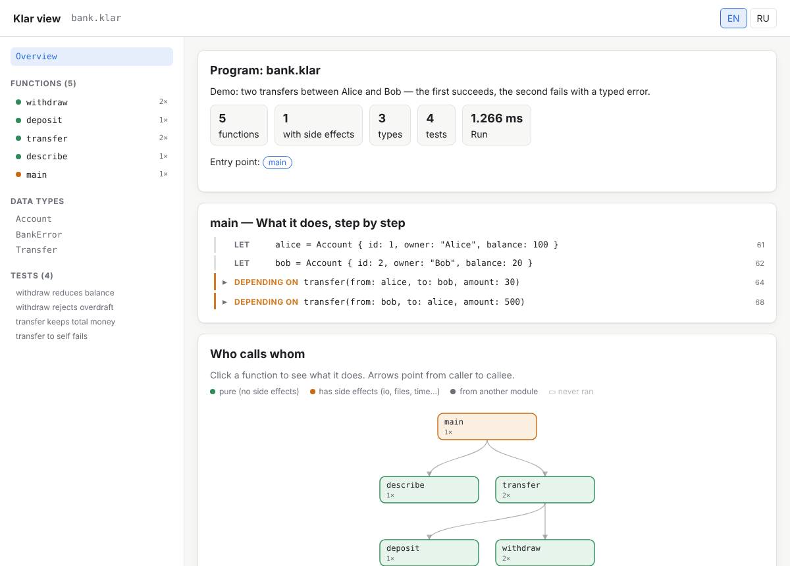
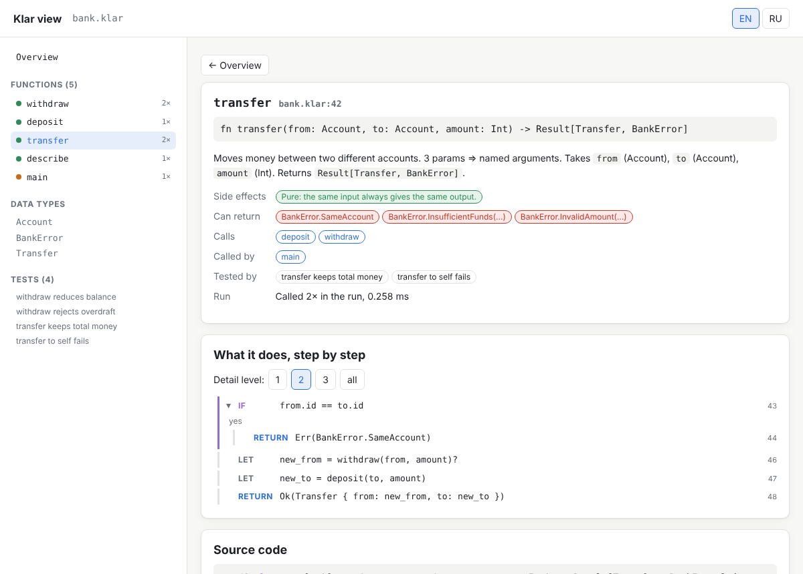
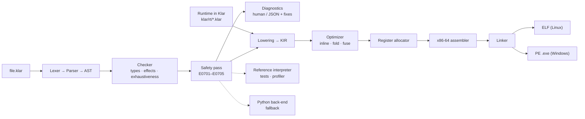
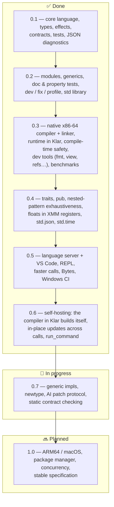

<div align="center">

# Klar

**A fast, compile-time-safe programming language designed for AI authors.**

[](https://github.com/veosett/Klar/actions/workflows/ci.yml)
[](LICENSE)


[Русская версия](README.ru.md) · [**Guide in pictures**](docs/GUIDE.en.md) · [Tools](docs/TOOLS.md) ·
[Architecture](docs/ARCHITECTURE.md) · [Specification](docs/SPEC.md) ·
[Speed benchmark](bench/README.md) · [AI benchmark](bench/ai/README.md) · [Changelog](CHANGELOG.md)

</div>

---

## Goal

Language models now write a large share of all code — but they write it in languages designed for humans, and
they fail in predictable ways: they mix up idioms of different languages, forget to handle errors and missing
values, expect immutable values to change, miss enum cases, swap arguments, and divide by values that can be zero.
Worst of all, many of these mistakes **run without an error and silently print a wrong result**.

**Klar** is built around the AI as the author and the human as the reviewer:

1. **Catch mistakes before the program runs** — like Rust, everything that can be ruled out at compile time is
   rejected by the compiler, with the exact location, a hint and often a machine-applicable fix.
2. **Make the feedback loop cheap** — one command (`klar dev --json`) checks, tests and runs, and returns compact
   JSON with a `next` step; the whole language reference fits into ~2,000 tokens (`klar spec`).
3. **Be fast** — Klar compiles to native x86-64 machine code with its **own compiler and linker**: no C compiler,
   no libc, no virtual machine.
4. **Be autonomous** — the runtime and the compiler are written in Klar itself: `klarc` builds itself.

```klar
use std.math.{gcd}

/// Withdraws money from an account.
/// >>> assert withdraw(Account { id: 1, balance: 100 }, 30) == Ok(Account { id: 1, balance: 70 })
fn withdraw(acc: Account, amount: Int) -> Result[Account, BankError]
  requires amount > 0
{
  if acc.balance < amount {
    return Err(BankError.InsufficientFunds(need: amount, have: acc.balance))
  }
  return Ok(acc with { balance: acc.balance - amount })
}

property "balance never goes negative" (start: Int, amount: Int) {
  match withdraw(Account { id: 1, balance: start.abs() }, amount.abs() + 1) {
    Ok(acc) => { assert acc.balance >= 0 },
    Err(_) => { },
  }
}
```

## What the compiler catches

```text
error[E0701]: division by `count`, which may be zero
  --> stats.klar:2:18
    |
  2 |   return total / count
    |                  ^^^^^
  hint: prove the divisor is not zero first: `if count != 0 { ... }`, `match count { 0 => ..., _ => ... }`,
        an early `if count == 0 { return ... }`, or make it the caller's job: `requires count != 0`
  maybe: insert at 1:38 ' requires count != 0'
```

| the mistake | in most languages | in Klar |
|---|---|---|
| using a possibly-missing value (`map.get(k) + 1`) | crash or silent `0` / `NaN` | compile error: handle `Option` |
| ignoring a parse error | crash or a silently wrong number | compile error: handle `Option`/`Result` |
| dividing by something that may be 0 | crash or `NaN` | compile error until the divisor is proven ≠ 0 |
| `s.trim()` / `xs.push(1)` without assigning | silently does nothing | compile error E0405 (+ fix) |
| a forgotten enum case | often silent | compile error listing the missing arms |
| swapped same-typed arguments | silent | named arguments are required for ≥ 3 parameters |
| integer overflow | silent / crash | impossible: `Int` is arbitrary precision |
| `xs[len]`, off by one | crash / undefined behaviour | no indexing; `xs.get(xs.len())` is a compile error |
| recursion without a base case | stack overflow | compile error E0702 |
| `null`, exceptions, data races | everywhere | do not exist |

**AI benchmark** ([`bench/ai`](bench/ai/README.md)): the same 13 typical AI mistakes written idiomatically in
7 languages. Klar stops **13 / 13** before the program runs (Rust 4 + 3 warnings, TypeScript strict 4,
Python + mypy 6 / 12, Java 5, Go 4, C++ 2), produces **no silently wrong result** (TypeScript and C++: 8 / 13),
and every message carries a fix hint (Rust: 6 / 12, the others: none).

## Tooling

Built for an AI author **and** a human reviewer ([docs/TOOLS.md](docs/TOOLS.md)):

| for the AI author | | for the human reviewer | |
|---|---|---|---|
| `klar dev f.klar --json` | check + tests + run in one step | `klar view f.klar --run` | interactive HTML: overview → call graph → each function step by step |
| `klar doc split` | signature + tested examples | `klar outline f.klar` | the API of a file in a few lines |
| `klar eval '<expr>'` | value and type, no file needed | `klar coverage f.klar` | statements the tests never run |
| `klar fix` / `klar fmt` | safe fixes, canonical layout | `klar lsp` + `editors/vscode` | errors as you type, hover, go to definition, rename, completion |
| `klar refs` / `klar rename` | exact (no shadowing in Klar) | `klar new app` | project skeleton with tests and `AGENTS.md` |

`klar view` turns any Klar program into a page a human can read — the big picture first, details on demand:

<p>
</p>

## Speed

Compute time in milliseconds, best of 5, lower is better (2 vCPU x86-64 Linux; full methodology and other
machines in [bench/README.md](bench/README.md)):

| benchmark | C -O2 | C++ -O2 | Rust -O | Go | **Klar** | Java 21 | Node.js 22 | Python 3.13 |
|---|---:|---:|---:|---:|---:|---:|---:|---:|
| `fib(25)` — function calls | 0.11 | 0.11 | 0.16 | 0.34 | **0.71** | 1.0 | 2.2 | 8.1 |
| `loop` — integer arithmetic | 1.0 | 1.0 | 1.1 | 1.0 | **1.5** | 3.3 | 6.9 | 24.4 |
| `primes` — division, branches | 0.84 | 0.84 | 0.60 | 0.85 | **1.0** | 2.9 | 2.6 | 15.7 |
| `mandelbrot` — floating point | 0.27 | 0.29 | 0.25 | 0.28 | **0.37** | 3.4 | 5.3 | 10.5 |
| `collections` — map/filter/sort 200k | 5.0 | 4.1 | 2.2 | 12.5 | **7.1** | 40.2 | 33.9 | 26.5 |
| `strings` — 100k strings, join/split | 8.2 | 9.9 | 9.4 | 15.5 | **13.3** | 40.2 | 33.0 | 17.9 |

Klar is 1.3–28× faster than CPython, faster than Node.js and Java on all six, close to C on integer and
floating-point code (1.2–1.4×; floats live in XMM registers) and faster than Go on collections and strings — while `Int` never overflows, values are immutable and every error
shows a Klar stack trace. An executable starts in 1–2 ms.

## How it works



* Values are 64-bit words: small `Int`s are tagged inline (`(n << 1) | 1`; overflow transparently becomes a bignum),
  heap objects carry a reference count and a type descriptor. Values are immutable, so reference counting needs no
  cycle collector, and uniquely referenced values are updated in place (`xs = xs.push(v)` is amortized O(1)) —
  also across function calls and inside records: a parameter the function consumes is passed owned, the last use of
  a variable moves it, and `s with { items: s.items.push(x) }` reuses a unique record.
* Executables call only the OS: raw syscalls on Linux, `KERNEL32.dll` on Windows. Typical size: 50–150 KB.
* Every back-end must produce identical output and error codes — `tests/native_diff.py` checks it on Linux and
  Windows.

Details: [docs/ARCHITECTURE.md](docs/ARCHITECTURE.md) (in Russian).

## Status and roadmap



| area | status |
|---|---|
| Language core: types with inference, generics, records/enums, `Option`/`Result`/`?`, `match`, modules | ✅ |
| Traits with default methods and bounded generics (`fn f[T: Shape]`), static dispatch in native code | ✅ 0.4 |
| Effects (`uses io`), contracts (`requires`/`ensures`), immutability with in-place updates | ✅ |
| Tests, doc-tests, property tests with shrinking, profiler | ✅ |
| Native compiler for x86-64 Linux and Windows, own linker, runtime in Klar | ✅ |
| Compile-time safety pass (division, recursion, contracts, built-in domains, indexes) | ✅ |
| AI tooling: `dev --json`, `fix`, `spec`, `explain`, stable error codes | ✅ |
| Language server (`klar lsp`) and VS Code extension: diagnostics, hover, definition, references, rename, completion | ✅ 0.5 |
| Self-hosted compiler: `compiler/klarc.klar` builds, runs and tests programs and builds itself (stage1 == stage2 == stage3, byte for byte), faster than the Python implementation | ✅ 0.6 |
| ARM64, macOS, package manager | 🔜 1.0 |

## Quick start

Requirements: **Python 3.10+** (no dependencies) for the `klar` tool and to bootstrap `klarc`, the compiler written
in Klar (see below). Compiled programs need nothing.

```sh
git clone https://github.com/veosett/Klar.git && cd Klar
python -m klar run examples/hello.klar          # compile to machine code (cached) and run
python -m klar build examples/shapes.klar       # standalone executable
python -m klar build app.klar --target windows  # cross-compile a .exe from Linux (or the reverse)
python -m klar dev examples/bank.klar --json    # one AI-loop step: check + tests + run
python -m klar test examples/bank.klar          # tests, doc-tests, properties
python -m klar fix examples/mistakes.klar       # apply all safe fixes
python -m klar spec                             # the language reference for a prompt
python -m klar explain E0701
```

The compiler written in Klar (`compiler/`, self-hosted) builds without Python once it has been bootstrapped:

```sh
python -m klar build compiler/klarc.klar -o klarc   # stage 1: the Python compiler builds klarc
./klarc build compiler/klarc.klar -o klarc2         # stage 2: klarc builds itself (the same bytes)
./klarc build examples/hello.klar --lib klar        # check + compile a program, no Python involved
./klarc run examples/shapes.klar -- arg1 arg2       # build into a temporary file and run it
./klarc test examples/bank.klar                     # build the `test` blocks and run each one
```

`pip install -e .` installs a `klar` command. On Windows `klar.bat run examples\hello.klar` works from the
repository root, on Linux `sh klar.sh ...`.

## Repository

```
klar/            compiler front-end, safety pass, interpreter, Python back-end, CLI
klar/native/     native compiler: lowering, KIR, optimizer, register allocator, x86-64, linker
klar/rt/         runtime of native executables, written in Klar
compiler/        the compiler written in Klar (self-hosted): klarc.klar + lexer … emit, link
klar/std/        standard modules in Klar (std.math, std.text, std.list, std.result, std.set, std.json, std.time)
examples/        example programs (examples/mistakes.klar: typical AI mistakes)
tests/           test-suite, differential tests native vs interpreter
bench/           speed benchmark (8 languages); bench/ai: AI-ergonomics benchmark (7 languages)
docs/            architecture, specification, analysis of languages → feature list
```

## Contributing

See [CONTRIBUTING.md](CONTRIBUTING.md). Issues and pull requests are welcome.

## License

[MIT](LICENSE) © 2026 veosett
