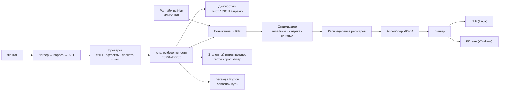
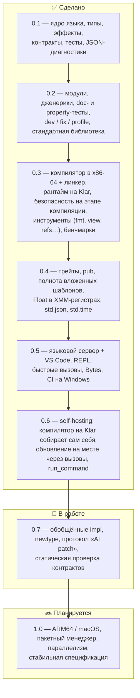

<div align="center">

# Klar

**Быстрый язык программирования с проверкой ошибок на этапе компиляции, спроектированный для ИИ.**

[](https://github.com/veosett/Klar/actions/workflows/ci.yml)
[](LICENSE)


[English](README.md) · [**Руководство в картинках**](docs/GUIDE.md) · [Инструменты](docs/TOOLS.md) ·
[Архитектура](docs/ARCHITECTURE.md) · [Спецификация](docs/SPEC.md) ·
[Анализ языков](docs/FEATURES.md) · [Бенчмарк скорости](bench/README.md) · [Бенчмарк для ИИ](bench/ai/README.md) ·
[История изменений](CHANGELOG.md)

</div>

---

## Цель проекта

Языковые модели уже пишут огромную долю кода — но на языках, созданных для людей, и ошибаются предсказуемо:
путают идиомы разных языков, забывают обработать ошибку или отсутствующее значение, ждут, что неизменяемое значение
изменится, пропускают вариант enum, путают порядок аргументов, делят на то, что может быть нулём. Хуже всего то,
что многие такие ошибки **не падают, а молча печатают неверный результат**, и модель считает задачу решённой.

**Klar** устроен вокруг ИИ-автора и человека-ревьюера:

1. **Ошибки — до запуска.** Как в Rust: всё, что можно отсечь на этапе компиляции, отсекает компилятор — с точным
   местом, подсказкой и часто с готовой машинной правкой.
2. **Дешёвый цикл исправления.** Одна команда `klar dev --json` проверяет, тестирует и запускает программу и
   возвращает компактный JSON с полем `next`. Весь справочник языка — ~2 тыс. токенов (`klar spec`).
3. **Скорость.** Klar компилируется в машинный код x86-64 **собственным компилятором и линкером**: без C-компилятора,
   без libc, без виртуальной машины.
4. **Автономность.** Рантайм и компилятор написаны на самом Klar: `klarc` собирает сам себя.

```klar
use std.math.{gcd}

/// Списывает деньги со счёта
/// >>> assert withdraw(Account { id: 1, balance: 100 }, 30) == Ok(Account { id: 1, balance: 70 })
fn withdraw(acc: Account, amount: Int) -> Result[Account, BankError]
  requires amount > 0
{
  if acc.balance < amount {
    return Err(BankError.InsufficientFunds(need: amount, have: acc.balance))
  }
  return Ok(acc with { balance: acc.balance - amount })
}
```

## Что ловит компилятор

```text
error[E0701]: division by `count`, which may be zero
  --> stats.klar:2:18
    |
  2 |   return total / count
    |                  ^^^^^
  hint: prove the divisor is not zero first: `if count != 0 { ... }`, `match count { 0 => ..., _ => ... }`,
        an early `if count == 0 { return ... }`, or make it the caller's job: `requires count != 0`
  maybe: insert at 1:38 ' requires count != 0'
```

| ошибка | в большинстве языков | в Klar |
|---|---|---|
| значение, которого может не быть (`map.get(k) + 1`) | падение или молча `0` / `NaN` | ошибка компиляции: обработайте `Option` |
| не обработана ошибка разбора числа | падение или молча неверное число | ошибка компиляции |
| деление на то, что может быть нулём | падение или `NaN` | ошибка компиляции, пока не доказано, что делитель ≠ 0 |
| `s.trim()` / `xs.push(1)` без присваивания | молча ничего не делает | ошибка E0405 с правкой |
| забыт вариант enum | часто молча | ошибка с текстом недостающих веток |
| перепутаны однотипные аргументы | молча | при ≥3 параметрах аргументы только именованные |
| переполнение целого | молча / падение | невозможно: `Int` произвольной точности |
| `xs[len]`, выход за границу | падение / неопределённое поведение | индексации нет; `xs.get(xs.len())` — ошибка компиляции |
| рекурсия без базового случая | переполнение стека | ошибка E0702 |
| `null`, исключения, гонки данных | везде | не существуют |

**Бенчмарк для ИИ** ([`bench/ai`](bench/ai/README.md)): 13 типичных ошибок моделей, одинаково написанных на 7 языках.
Klar останавливает до запуска **13 из 13** (Rust — 4 и ещё 3 предупреждения, TypeScript strict — 4,
Python + mypy — 6 из 12, Java — 5, Go — 4, C++ — 2), **ни разу не выдаёт молча неверный результат**
(TypeScript и C++ — 8 из 13), и каждое сообщение содержит подсказку исправления (Rust — 6 из 12, остальные — ни одного).

## Инструменты

Для ИИ-автора **и** человека-ревьюера ([docs/TOOLS.md](docs/TOOLS.md)):

| для ИИ-автора | | для человека | |
|---|---|---|---|
| `klar dev f.klar --json` | проверка + тесты + запуск за один шаг | `klar view f.klar --run` | интерактивная HTML-схема: обзор → граф вызовов → функция по шагам |
| `klar doc split` | сигнатура + проверенные примеры | `klar outline f.klar` | API файла в нескольких строках |
| `klar eval '<выражение>'` | значение и тип без файла | `klar coverage f.klar` | что тесты не выполняют |
| `klar fix` / `klar fmt` | безопасные правки, единый вид | `klar lsp` + `editors/vscode` | ошибки при наборе, наведение, переход к определению, переименование, дополнение |
| `klar refs` / `klar rename` | точно (в Klar нет затенения) | `klar new app` | заготовка проекта с тестами и `AGENTS.md` |

`klar view` превращает любую программу, которую написал ИИ, в страницу для человека: сначала общая картина, детали — по клику:

<p>
</p>

## Скорость

Время вычислений, мс, лучшее из 5, меньше — лучше (Linux x86-64, 2 vCPU; методика и другие машины — в
[bench/README.md](bench/README.md)):

| задача | C -O2 | C++ -O2 | Rust -O | Go | **Klar** | Java 21 | Node.js 22 | Python 3.13 |
|---|---:|---:|---:|---:|---:|---:|---:|---:|
| `fib(25)` — вызовы функций | 0,11 | 0,11 | 0,16 | 0,34 | **0,71** | 1,0 | 2,2 | 8,1 |
| `loop` — целочисленная арифметика | 1,0 | 1,0 | 1,1 | 1,0 | **1,5** | 3,3 | 6,9 | 24,4 |
| `primes` — деление, ветвления | 0,84 | 0,84 | 0,60 | 0,85 | **1,0** | 2,9 | 2,6 | 15,7 |
| `mandelbrot` — Float | 0,27 | 0,29 | 0,25 | 0,28 | **0,37** | 3,4 | 5,3 | 10,5 |
| `collections` — map/filter/sort 200 тыс. | 5,0 | 4,1 | 2,2 | 12,5 | **7,1** | 40,2 | 33,9 | 26,5 |
| `strings` — 100 тыс. строк, join/split | 8,2 | 9,9 | 9,4 | 15,5 | **13,3** | 40,2 | 33,0 | 17,9 |

Klar в 1,3–28 раз быстрее CPython, быстрее Node.js и Java на всех шести задачах, близок к C на
целочисленном коде и коде с Float (1,2–1,4×; Float живут в XMM-регистрах) и быстрее Go на коллекциях и строках. При этом `Int` не переполняется, значения неизменяемы, а
ошибки показывают стек вызовов Klar. Исполняемый файл стартует за 1–2 мс.

## Как это устроено



* Значения — 64-битные слова: маленькие `Int` хранятся прямо в слове (`(n << 1) | 1`, переполнение незаметно
  превращается в большое число), объекты кучи несут счётчик ссылок и дескриптор типа. Значения неизменяемы, поэтому
  сборщик циклов не нужен, а значения с единственной ссылкой обновляются на месте (`xs = xs.push(v)` — O(1)).
* Исполняемый файл обращается только к ОС: системные вызовы на Linux, `KERNEL32.dll` на Windows. Размер — 50–150 КБ.
* Все бэкенды обязаны давать одинаковый вывод и коды ошибок — это проверяет `tests/native_diff.py` на Linux и Windows.

Подробно — [docs/ARCHITECTURE.md](docs/ARCHITECTURE.md).

## Что сделано и что планируется



| направление | статус |
|---|---|
| Ядро языка: вывод типов, дженерики, записи/enum, `Option`/`Result`/`?`, `match`, модули | ✅ |
| Трейты с методами по умолчанию и ограничения дженериков (`fn f[T: Shape]`), статическая диспетчеризация в машинном коде | ✅ 0.4 |
| Эффекты (`uses io`), контракты (`requires`/`ensures`), неизменяемость с обновлением на месте | ✅ |
| Тесты, doc-тесты, property-тесты со сжатием, профайлер | ✅ |
| Компилятор в машинный код x86-64 для Linux и Windows, свой линкер, рантайм на Klar | ✅ |
| Анализ безопасности на этапе компиляции (деление, рекурсия, контракты, индексы) | ✅ |
| Инструменты для ИИ: `dev --json`, `fix`, `spec`, `explain`, стабильные коды ошибок | ✅ |
| Языковой сервер (`klar lsp`) и расширение VS Code: ошибки при наборе, наведение, определения, ссылки, переименование, дополнение | ✅ 0.5 |
| Компилятор на самом Klar: `compiler/klarc.klar` собирает, запускает и тестирует программы и собирает сам себя (stage1 == stage2 == stage3 побайтно), быстрее Python-реализации | ✅ 0.6 |
| ARM64, macOS, пакетный менеджер | 🔜 1.0 |

## Быстрый старт

Нужен **Python 3.10+** (без зависимостей) — для инструмента `klar` и чтобы один раз собрать `klarc`, компилятор
на самом Klar (см. ниже).
Скомпилированным программам не нужно ничего.

```sh
git clone https://github.com/veosett/Klar.git && cd Klar
python -m klar run examples/hello.klar          # компиляция в машинный код (с кэшем) и запуск
python -m klar build examples/shapes.klar       # один исполняемый файл без зависимостей
python -m klar build app.klar --target windows  # .exe из Linux (и наоборот)
python -m klar dev examples/bank.klar --json    # один шаг цикла ИИ: проверка + тесты + запуск
python -m klar test examples/bank.klar          # тесты, doc-тесты, property-тесты
python -m klar fix examples/mistakes.klar       # применить все безопасные исправления
python -m klar spec                             # справка по языку для промпта
python -m klar explain E0701
```

Компилятор на Klar (`compiler/`) после сборки работает без Python:

```sh
python -m klar build compiler/klarc.klar -o klarc   # stage 1: Python-компилятор собирает klarc
./klarc build compiler/klarc.klar -o klarc2         # stage 2: klarc собирает сам себя (те же байты)
./klarc run examples/shapes.klar -- arg1 arg2       # собрать во временный файл и запустить
./klarc test examples/bank.klar                     # собрать блоки `test` и запустить каждый
```

`pip install -e .` установит команду `klar`. На Windows из корня репозитория работает `klar.bat run examples\hello.klar`,
на Linux — `sh klar.sh ...`.

## Структура репозитория

```
klar/            фронтенд, анализ безопасности, интерпретатор, бэкенд Python, CLI
klar/native/     компилятор в машинный код: понижение, KIR, оптимизатор, регистры, x86-64, линкер
klar/rt/         рантайм исполняемых файлов на Klar
klar/std/        стандартные модули на Klar (std.math, std.text, std.list, std.result)
examples/        примеры (examples/mistakes.klar — типичные ошибки ИИ)
tests/           тесты компилятора, дифференциальные тесты native vs интерпретатор
bench/           бенчмарк скорости (8 языков); bench/ai — бенчмарк для ИИ (7 языков)
docs/            архитектура, спецификация, анализ языков → список функций
```

## Участие

См. [CONTRIBUTING.md](CONTRIBUTING.md). Issues и pull request'ы приветствуются.

## Лицензия

[MIT](LICENSE) © 2026 veosett
