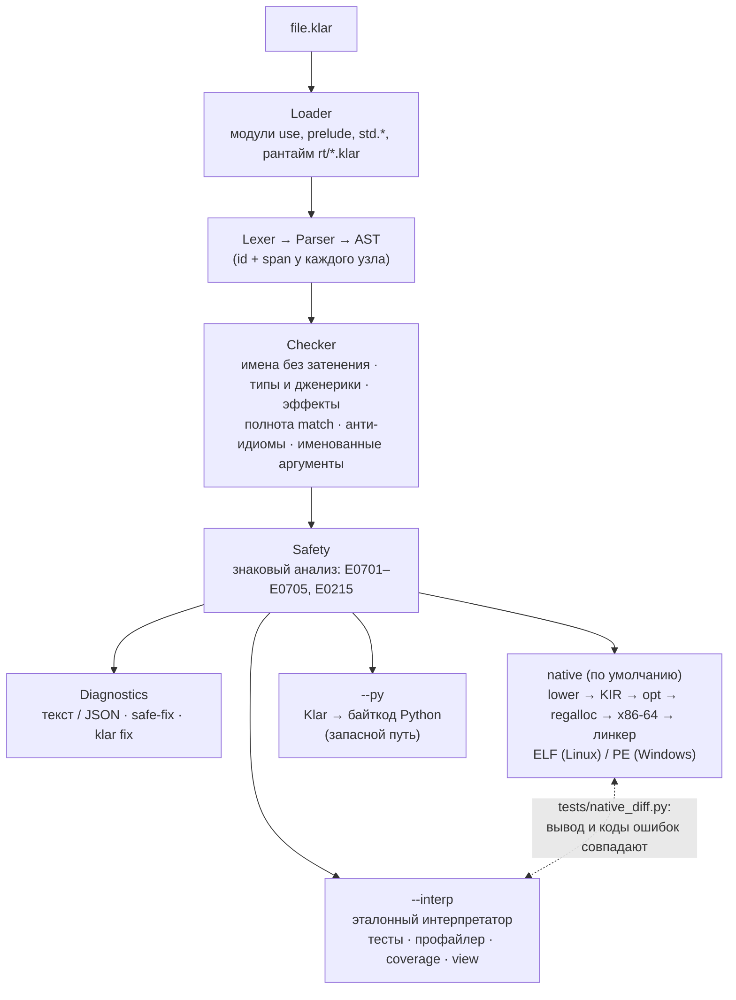
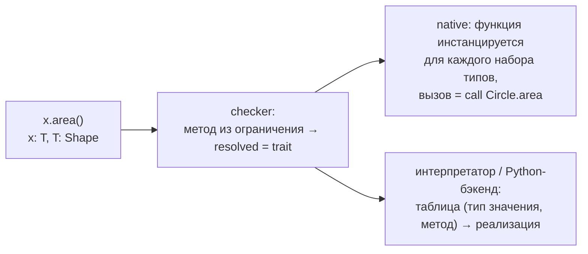
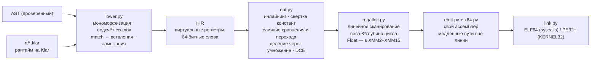
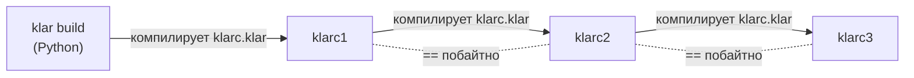
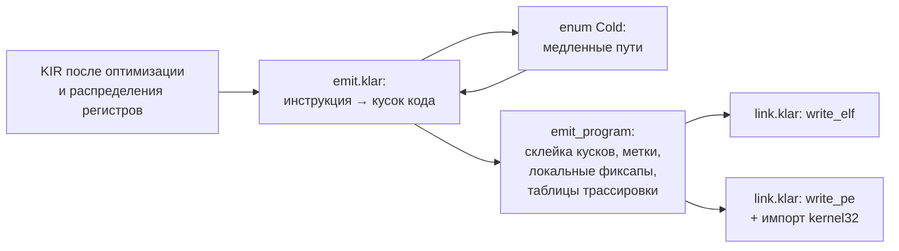
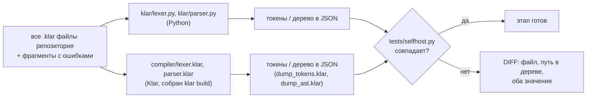

# Klar — архитектура языка, спроектированного для ИИ

> **Klar** (нем./швед. «ясный») — язык программирования, в котором главный автор и читатель кода — языковая модель,
> а человек — ревьюер. Версия документа: **0.3** — собственный компилятор в машинный код x86-64 (Linux и Windows).

---

## 1. Проблема: почему существующие языки неудобны для ИИ

Когда модель пишет код, она ошибается по-другому, чем человек. Типичные провалы:

| Проблема у ИИ | Откуда берётся | Чем отвечает Klar |
|---|---|---|
| Путает идиомы разных языков (`.length` vs `len()` vs `.size()`) | Обучение на десятках языков сразу | Один способ сделать вещь + компилятор подсказывает «в Klar это называется `len`» |
| Скрытое изменение состояния: думает, что `list.push()` меняет список (или наоборот) | Неявная мутация и алиасинг | Все значения неизменяемы; выброшенный результат `xs.push(1)` — **ошибка** |
| Забывает обработать ошибку | Исключения невидимы в сигнатуре | Ошибки — значения (`Result`), игнорировать `Result` нельзя |
| Не видит побочных эффектов функции | Эффекты не объявлены | Эффекты в сигнатуре: `uses io, time` — проверяются компилятором |
| Переиспользует имя переменной и путается | Затенение (shadowing) | Затенение запрещено |
| Путает порядок аргументов | Позиционные аргументы | При ≥3 параметрах аргументы **обязательно именованные** |
| Пропускает ветку `match` | Нет проверки полноты | Проверка исчерпываемости + готовый текст недостающих веток |
| Не может проверить себя | Тесты в отдельных файлах, нужен фреймворк | `test`, doc-тесты, `property` и контракты `requires/ensures` встроены в язык |
| Читает ошибки компилятора «как человек» | Ошибки — свободный текст | Диагностики в JSON: код, позиция, подсказка, машинный `fix` с флагом `safe` |
| Не помнит язык (новый язык не был в обучении) | Спецификация огромна | Вся справка по языку — ~2 тыс. токенов, выдаётся командой `klar spec` |
| Ломается на отступах/скобках при частичных правках | Значимые пробелы, длинные вложенности | Фигурные скобки, одна инструкция на строку, без `;` |
| Тратит шаги на «собери → запусти → посмотри» | Разрозненные инструменты | `klar dev --json`: проверка + тесты + запуск за один вызов, с полем `next` |

## 2. Принципы дизайна

1. **Знакомое лучше нового.** Синтаксис — смесь Rust/TypeScript/Python, которую модель видела миллиарды раз. Новизна только там, где она убирает класс ошибок.
2. **Один канонический способ.** Нет `;`, нет `&&`/`||` (только `and`/`or`), нет тернарного оператора, нет перегрузки, нет неявных преобразований. Меньше вариантов → меньше галлюцинаций.
3. **Локальность рассуждения.** Чтобы понять функцию, достаточно прочитать её сигнатуру и тело: типы параметров обязательны, эффекты объявлены, глобального изменяемого состояния нет.
4. **Явное лучше неявного.** Нет `null` (есть `Option`), нет исключений (есть `Result` и `?`), нет значений по умолчанию у полей, нет неявных `return`.
5. **Ошибки компилятора — это API для модели.** Каждая ошибка имеет стабильный код (`E0202`), точный span, подсказку, а часто и машинно-применимый `fix`. `klar fix` применяет безопасные правки сам.
6. **Самопроверка встроена.** Контракты, `assert` с выводом обеих сторон, тесты рядом с кодом, property-тесты со сжатием контрпримера, детерминированное исполнение.
7. **Детерминизм.** `Int` — произвольной точности (нет переполнений), нет неопределённого поведения, порядок обхода `Map` — порядок вставки, случайность и время — только через эффекты.
8. **Анти-идиомы распознаются.** Компилятор знает типичные «чужие» привычки модели (`unwrap`, `forEach`, `.length`, `!x`, `&&`, `null`) и сразу говорит, как это пишется в Klar.
9. **Автономность и скорость.** Программа на Klar компилируется собственным компилятором прямо в машинный код и собственным линкером — в исполняемый файл ELF/PE. Ни C-компилятора, ни libc, ни Python во время выполнения не нужно. Одинаковый результат на всех бэкендах гарантируется дифференциальными тестами.

## 3. Обзор тулчейна



### Компоненты (каталог `klar/`)

| Модуль | Ответственность |
|---|---|
| `lexer.py` | Токены, интерполяция строк, перевод строки как терминатор, детектор «чужих» операторов (`&&`, `!`, `;`) с fix |
| `parser.py` | Рекурсивный спуск, AST со span'ами; разбор сигнатур встроенных функций тем же парсером |
| `nodes.py` | Узлы AST, стабильные `id`, экспорт в JSON (`klar ast`) |
| `types.py` | Типы, переменные типов, унификация с откатом |
| `checker.py` | Семантический анализ; режим `sys` для рантайма (тип `Word`, интринсики) |
| `loader.py` | Модули, prelude, std, сборка рантайма `rt/*.klar` в один модуль `klar_rt` |
| `builtins.py` | Стандартная библиотека для интерпретатора: сигнатуры **на Klar** + реализации |
| `interpreter.py` | Эталонное исполнение, контракты, стек вызовов, тест-раннер, property-тесты, профайлер |
| `codegen.py` | Бэкенд Klar → Python (запасной путь, если native не умеет конструкцию) |
| `native/` | **Компилятор в машинный код** (см. раздел 5) |
| `rt/*.klar` | **Рантайм на самом Klar** (системное подмножество): память, строки, Int, Float, List, Map, вывод, ОС |
| `std/*.klar` | Стандартные модули на Klar (`std.math`, `std.text`, `std.list`, `std.result`) с тестами |
| `diagnostics.py` | Формат ошибок, каталог кодов, `explain`, fix-правки |
| `cli.py` | `run / build / check / test / dev / fix / profile / ast / spec / explain` |

## 4. Ключевые решения языка

### 4.1 Синтаксис: скобки + перевод строки
* Блоки — `{ }` (самый частый формат в обучающих данных; устойчив к частичному редактированию).
* Инструкция заканчивается переводом строки. Внутри `( )` и `[ ]` переводы строк игнорируются.
* Строка, начинающаяся с `.`, продолжает цепочку методов. Чтобы перенести выражение в другом месте, строку заканчивают оператором; если строка начинается с `+`, компилятор так и подсказывает.

### 4.2 Типы
* Примитивы: `Int` (большие целые), `Float`, `Bool`, `Str`, `Unit`, `Never`.
* Встроенные обобщённые: `List[T]`, `Map[K, V]`, `Option[T]`, `Result[T, E]`, функции `fn(A, B) -> R`.
* Пользовательские: `type` (запись, может быть обобщённой), `enum` (сумма, может быть обобщённой и рекурсивной), алиасы `type Id = Int`, константы `const MAX: Int = 10`.
* Аннотации — только на границах (параметры и результат функций). Внутри тела — вывод типов.
* **Нет неявных преобразований.** `Int + Float` — ошибка с подсказкой `.to_float()`.
* **Трейты** (`trait`, `impl Trait for Type`, методы по умолчанию, ограничения `fn f[T: A + B]`) — единственный
  механизм полиморфизма; наследования и трейт-объектов нет. Разнородные значения моделируются `enum`, для которого
  пишется `impl`. Для каждой пары (трейт, тип) в программе ровно один `impl`, и он лежит рядом с трейтом или с
  типом: какую реализацию вызовет `x.m()`, видно по одному поиску, без правил разрешения.



Методы `impl` и методы по умолчанию становятся обычными функциями с квалифицированными именами (`Circle.area`,
`Shape.label`; метод по умолчанию — обобщённый по `Self`). Поэтому их без изменений обрабатывают профайлер,
трассировки, покрытие, `klar view` и анализ безопасности. Проверки соответствия `impl` трейту и наличия
реализаций для типов-аргументов выполняет `checker.py` (E0220–E0224).

### 4.3 Неизменяемость
* Все значения неизменяемы. `let` — неизменяемая привязка, `var` — переназначаемая.
* Обновление записи: `acc with { balance: 10 }`. Методы коллекций возвращают новые значения.
* `xs.push(1)` отдельной инструкцией → `E0405` (самая частая ошибка модели — ожидание мутации).
* Для скорости компилятор делает **обновление на месте**, когда это ненаблюдаемо: `xs = xs.push(v)` при счётчике ссылок 1 не копирует список (см. 5.4).

### 4.4 Эффекты
* Функция без `uses` — чистая. Эффекты: `io`, `time`, `rand`, `fs`, `net`.
* Вызов функции с эффектом из функции, которая его не объявила, — `E0401` с готовой правкой сигнатуры.

### 4.5 Ошибки как значения
* `Result[T, E]` и `Option[T]` + оператор `?`. Игнорировать `Result` нельзя (`E0402`); явный отказ — `let _ = ...`.
* `fail("msg")` и `todo("что")` — аварийная остановка (тип `Never`).

### 4.6 Самопроверка
* `test "..." { }`, doc-тесты `/// >>> assert f(2) == 4`, `property "..." (xs: List[Int]) { }` — 100 случайных входов, сжатие контрпримера.
* Контракты `requires`/`ensures`: нарушение показывает текст условия и значения переменных.

### 4.7 Диагностики как протокол
```json
{"code": "E0401", "severity": "error",
 "message": "calling `print` requires effect `io`, but `report` does not declare it",
 "span": {"file": "a.klar", "line": 7, "col": 3, "end_line": 7, "end_col": 15},
 "hint": "add `uses io` to the signature of `report`",
 "fix": {"safe": true, "edits": [{"span": {...}, "text": " uses io"}]}}
```
`safe: true` — правка не меняет смысл программы и применяется `klar fix` автоматически; «did you mean» — `safe: false`.

### 4.8 Правила, которые снижают число ошибок модели
Запрещено затенение (`E0102`); `PascalCase` для типов; ≥3 параметров → именованные аргументы (`E0208`);
варианты enum всегда квалифицированы; нет `if`-выражения (для выбора значения — `match`); нет `xs[i]`
(есть `xs.get(i) -> Option[T]`); нет `unwrap()`.

## 4.9 Безопасность на этапе компиляции (`klar/safety.py`)

Принцип как в Rust: всё, что можно отсечь до запуска, отсекает компилятор. После проверки типов работает
отдельный анализ:

* **знаковый анализ** (каждое значение — подмножество {−, 0, +}) с фактами из условий (`if`, `while`, `assert`,
  ранний `return`, `match b { 0 => ... }`, `requires`, `ensures result > 0` вызываемой функции, `xs.is_empty()`)
  и сводками для `var` (стартует положительной и только растёт → остаётся положительной);
* **E0701** — `Int`-деление без доказательства, что делитель ≠ 0 (для Float — только литерал 0.0);
* **E0702** — рекурсия без базового случая; **E0703** — константные аргументы нарушают `requires`;
* **E0704** — заведомо неверный аргумент встроенной функции; **E0705** — индекс за границей на каждом вызове;
* **E0215** — сортировка/min/max неупорядочиваемых значений.

Вместе с правилами самого языка (нет null, исключений, индексации, переполнений, затенения; обязательная обработка
`Option`/`Result`; полнота `match`) это убирает почти все классы ошибок времени выполнения. Что остаётся в рантайме:
`fail`/`todo`/`assert`, контракты на неконстантных данных, деление `Float` на вычисленный ноль, слишком глубокая
(но конечная) рекурсия, `List.set` с неверным индексом.

## 5. Нативный компилятор (`klar/native/`)



### 5.1 Представление значений
* `Int`: если число помещается в 63 бита — **тегированное слово** `(n << 1) | 1`, иначе указатель на bignum (основание 2³⁰, деление Кнута D). Сложение, вычитание, умножение и сравнение маленьких чисел — несколько машинных инструкций с проверкой переполнения (`jo`); переполнение незаметно переходит в bignum.
* `Float` — биты IEEE-754 (SSE2; `sin/cos/ln/exp/pow` — x87 с расширенной точностью). Вывод — кратчайшее представление (Burger–Dybvig), как в интерпретаторе.
  Значения, которые в основном участвуют в вычислениях с плавающей точкой, распределяются в отдельный класс регистров
  XMM2–XMM15, если их интервал жизни не пересекает настоящий вызов. Медленные пути `Int` (переход в bignum),
  `free` и переполнение стека сохраняют XMM-регистры сами, поэтому не мешают. Инструкции, которые не знают про XMM,
  читают значение из его слота в стеке: туда оно записывается насквозь, только если такой читатель есть. Цепочки
  вроде `z = z*z + c` идут от регистра к регистру, без пересылок через регистры общего назначения.

### 5.1а Вызовы
* Глубина вызовов (R0006 после 10 000) считается в зарезервированном регистре R15: `add r15, 1` и сравнение на
  входе, `sub r15, 1` на выходе — без загрузки и записи глобальной переменной. `fib` стал быстрее на треть;
  точная граница 10 000 совпадает с интерпретатором. Стек вызовов для ошибок по-прежнему восстанавливается по
  цепочке RBP только в момент ошибки.
* Значения, которые живут поперёк вызова, получают сохраняемые регистры (RBX, R12–R14). Когда их не хватает,
  распределитель может дать и «портящийся» регистр (RSI, RDI, R8–R10), если значение используется чаще, чем
  выполняются вызовы. Тогда эмиттер сохраняет его вокруг именно этих вызовов.
* Вызовы внутри встроенных функций рантайма помечаются как холодные: это медленные пути (bignum, рост буфера).
  Они почти не выполняются, поэтому не мешают держать Float в XMM-регистрах, а XMM сохраняются вокруг них.
* `Bool`, `Unit` — 0/1 и 0; всё остальное — указатель на объект кучи `[rc][дескриптор типа][данные…]`, `rc < 0` — бессмертный объект (литералы).
* Дескриптор типа `[kind][name][a][b][c][d]` описывает элементы/поля — по нему рантайм печатает, сравнивает, хэширует и освобождает значения любого типа.

### 5.2 Память
* Подсчёт ссылок: параметры «одолжены», результаты «принадлежат» вызывающему. Циклов нет, потому что значения неизменяемы — сборщик мусора не нужен, паузы отсутствуют.
* Аллокатор: классы размеров по 16 байт со списками свободных блоков + bump-аллокация кусками от 1 до 64 МБ.
* Строковый билдер пишет прямо в блок, имеющий форму строки, — `sb_finish` превращает буфер в результат без копирования.

### 5.3 Рантайм на Klar
Весь рантайм (≈4,5 тыс. строк в `klar/rt/*.klar`) написан на **системном подмножестве Klar**: тип `Word` и
интринсики (`peek/poke`, `w_*`, `tag/untag`, `call1/call2`, `os_*`), которые компилятор превращает в инструкции.
Только тонкий слой ОС (≈30 инструкций на функцию: write/read/mmap/open/…) генерируется напрямую в `emit.py`.
Это первый шаг к self-hosting: на Klar уже написана самая большая часть того, что раньше было бы на C.

### 5.4 Обновление на месте («функционально, но на месте»)
`x = x.push(v)`, `m = m.set(k, v)`, `s = s + t` компилируются в `*_owned`-функции рантайма: если у значения
счётчик ссылок 1, оно меняется на месте (амортизированное O(1)), иначе копируется. Для программы это
ненаблюдаемо — семантика остаётся неизменяемой.

То же работает через вызовы функций и для записей (`klar/native/own.py`, `compiler/own.klar`), как в Lean 4 и Koka:

1. **Владеющие параметры.** Параметр, который функция потребляет (основа `with`, получатель `push`/`set`/…,
   значение `let`/`return`/поля записи или варианта, аргумент владеющего параметра другой функции), передаётся во
   владение — это неподвижная точка по графу вызовов. Остальные параметры по-прежнему одолжены.
2. **Перемещение при последнем использовании.** Обратный анализ живости по путям (`w`, `w.img`, `a.w`; `with` не
   читает заменяемые поля) находит последние использования локальных переменных. Такое значение передаётся без
   `retain`, а переменная получает бессмертный объект-заглушку (`obj_None`), так что очистка ничего не делает. Поле
   `a.f` записи-переменной «вынимается» (на его место ставится заглушка), если запись единственная.
3. **Запись на месте.** `x with { f: x.f.push(v) }`: единственная запись переиспользуется (иначе — копия), поле `f`
   вынимается и тоже обновляется на месте; вложенные `with` работают так же.

Безопасность: использование — кандидат на перемещение, только если в той же инструкции нет других ссылок на этот
путь, кроме других аргументов того же вызова (они удерживаются на время вызова) и значений полей `with`, чьей
основой он является (они читают обновляемую запись), а также ссылок внутри уже вычисленных подвыражений. Привязки
`match` считаются ссылками на сопоставляемое значение. `tests/native/ownership.klar` проверяет уникальные и общие
значения против интерпретатора.

Эффект на компиляторе, написанном в стиле «состояние в неизменяемой записи»: `klarc` собирает сам себя за 8 с
вместо 35 с (lowering — 3,3 с вместо 24 с), быстрее Python-компилятора.

### 5.5 Ошибки времени выполнения
Теневой стек вызовов (`g_frames`, глубина ≤ 10 000) хранит имя функции и место вызова — поэтому трассировка
ошибки, текст и код (`R0001`…) **совпадают** с интерпретатором. Переполнение стека — понятная `R0006`, а не segfault.

### 5.6 Сборка и кэш
`klar run` собирает программу (~0,4 с) в `~/.klar-cache` по хэшу исходников, рантайма и компилятора; повторный
запуск — мгновенный. `klar build file.klar [-o out] [--target windows|linux]` — кросс-компиляция в один файл
(≈100–150 КБ, без зависимостей). Если какая-то конструкция пока не поддержана native-бэкендом, `klar run`
незаметно использует Python-бэкенд (`-v` покажет причину).

### 5.7 Проверка корректности
* `tests/native_diff.py` — каждый пример, каждый std-модуль, все тесты stdlib и бенчмарки: вывод и коды ошибок native == интерпретатор (`--windows` — то же для `.exe` через wine).
* `tests/native/edge_cases.klar` — переполнения на всех быстрых путях, ветвления по bignum, давление на регистры, деление на константы, x87.
* `tests/test_klar.py` — 49 тестов фронтенда, трёх бэкендов и инструментов.

## 6. Self-hosting: путь к компилятору на самом Klar

Сейчас Python нужен только **во время компиляции** (как временный bootstrap); скомпилированные программы от него не зависят.

| Этап | Что делается | Статус |
|---|---|---|
| 0 | Рантайм на системном Klar (`klar/rt`) | ✅ готово |
| 1 | Нативный бэкенд с оптимизатором и регистровым аллокатором | ✅ готово |
| 2 | В язык: `Bytes` (запись на месте при единственной ссылке), побитовые операции на `Int`, чтение и запись файлов как байтов | ✅ готово |
| 3 | Лексер и парсер на Klar (`compiler/lexer.klar`, `parser.klar`), проверка на совпадение с Python-версией (`tests/selfhost.py`) | ✅ лексер и парсер совпадают с Python-версией на всех файлах репозитория (все токены, все узлы дерева со всеми позициями, синтаксические ошибки с подсказками); парсер разбирает и собственный исходник |
| 4а | Checker и загрузчик модулей на Klar (`compiler/types.klar`, `checker.klar`, `loader.klar`) | ✅ те же диагностики (код, текст, подсказка, позиция), что у Python-версии: все файлы репозитория и ~210 программ с ошибками, включая многомодульные |
| 4б | Анализ безопасности на Klar (`compiler/safety.klar`: знаки, факты из условий, сводки `var`, контракты, рекурсия) | ✅ те же E0701–E0705 и E0215; заодно сверяются типы всех ~47 тыс. выражений и разрешение каждого вызова метода |
| 4в | Lowering в KIR, оптимизатор и регистровый аллокатор на Klar (`compiler/lower.klar`, `opt.klar`, `regalloc.klar`) | ✅ тот же KIR (~790 тыс. инструкций до и после оптимизации), тот же образ данных побайтно и то же распределение регистров на всех 23 программах с `main`, включая сам компилятор на Klar |
| 4г | KIR → x86-64 и линкеры ELF/PE на Klar (`compiler/x64.klar`, `emit.klar`, `link.klar`) | ✅ побайтно те же исполняемые файлы Linux и Windows, что у `klar build`, для всех 23 программ с `main`, включая сам компилятор на Klar |
| 5 | Bootstrap: Python-компилятор собирает `klarc` (`compiler/klarc.klar`), затем `klarc` собирает сам себя; сравнение бинарников stage1 == stage2 | ✅ stage1 == stage2 == stage3 побайтно (4,5 МБ), `klarc` собирает и Windows-версию себя, рабочие программы и выдаёт те же ошибки (`tests/bootstrap.py`) |
| 5б | `klarc` как самостоятельный инструмент: `klarc run` (сборка во временный файл и запуск), `klarc test` (блоки `test`, каждый в своём процессе); в язык — запуск программ `run_command` (эффект `proc`) и `set_executable` | ✅ test-исполняемые файлы обоих компиляторов совпадают (22 файла), `klarc run`/`test` проверяет `tests/bootstrap.py` |
| 6 | Python-реализация остаётся эталонным интерпретатором для дифференциальных тестов | — |

Как проверяется каждый переписанный на Klar этап: оба компилятора получают одни и те же файлы, а сравниваются
их выходы в одинаковом JSON-виде — до последней позиции в исходнике и до текста сообщения об ошибке.

Checker на Klar устроен иначе, чем на Python, потому что значения в Klar неизменяемы: всё состояние проверки
(диагностики, области видимости, подстановка типовых переменных, общий реестр типов программы) лежит в одной записи
`Ck`, которая передаётся в каждую функцию и возвращается обновлённой (`Res { c, v }`). Унификация не меняет
переменные на месте, а возвращает расширенную подстановку или `None` — поэтому ей не нужен «журнал отката», как в
Python. Подстановка начинается заново для каждой функции: ни одна типовая переменная не переживает тело, где родилась.

Для lowering'а checker на Klar записывает то же, что Python-checker вешает на узлы дерева: тип каждого выражения,
разрешение каждого вызова метода, сигнатуру и подстановку типов каждого вызова, тип элемента каждого `for`. Ключ
таблиц — файл и позиция выражения (рантайм — один модуль из нескольких файлов).

Вторая реализация сразу окупилась: сравнение нашло в Python-checker'е две ошибки — падение на повторно объявленной
константе и пропуск сообщения E0216, зависевший от того, совпадут ли `id()` двух словарей (теперь каждая лямбда
получает свой номер). На этапе 4в нашлись ещё две вещи: парсер на Klar сворачивал `-0.0` в `+0.0` (сравнение
деревьев теперь сверяет Float по битам), а регистровый аллокатор Python при равных интервалах зависел от порядка
обхода `set` — теперь при равенстве решает номер vreg, и сборка не зависит от деталей CPython.

Эмиттер на Klar собирает машинный код кусками: каждая инструкция KIR, каждый вынесенный «холодный» блок и каждая
заглушка ОС ассемблируются в маленький кусок со своими метками, фиксапами и точками вызова (относительно начала
куска). Потом `emit_program` дописывает куски в код программы — локальную переменную, которая растёт на месте, —
и сдвигает метки. Так неизменяемые значения не превращают сборку двухмегабайтного кода в квадратичное копирование.
Холодный код в Python был замыканиями; в Klar это данные (`enum Cold`), которые эмиттер разворачивает после тела
функции.

Bootstrap (этап 5) замыкает круг: `klarc` — обычная программа на Klar, которая вызывает загрузчик, checker,
lowering, эмиттер и линкер. Неподвижная точка достигается сразу на втором шаге, потому что оба бэкенда уже
совпадают побайтно: `klarc`, собранный Python-компилятором, и `klarc`, собранный самим собой, — один и тот же файл.



Скорость `klarc`: сначала он собирал сам себя за ≈35 с против ≈8 с у Python-компилятора. Профиль (выборки стека
через gdb по карте `KLAR_MAP`) показал, что 57 % времени уходит на копирование `Map`: компилятор держит состояние в
неизменяемой записи, а `w with { spans: w.spans.set(k, v) }` копировал таблицу, потому что параметры были одолжены.
Перемещения и обновление записей на месте (5.4) сократили сборку до ≈8 с (`klarc build --time`: разбор и проверка
1 с, lowering 3,3 с, оптимизация и эмиттер 3,7 с, линковка 0,1 с) — теперь `klarc` быстрее Python-компилятора
(≈11 с), а неподвижная точка stage1 == stage2 == stage3 сохраняется.





## 7. Дорожная карта

| Версия | Что добавляется |
|---|---|
| 0.1 | Ядро языка, проверка типов/эффектов, интерпретатор, контракты, тесты, JSON-диагностики |
| 0.2 | Модули, дженерик-типы, алиасы, константы, guard'ы, doc- и property-тесты, `dev`/`fix`/`profile`, бэкенд Klar → Python |
| 0.3 | **Собственный компилятор в машинный код x86-64 + линкер ELF/PE**, рантайм на Klar, оптимизатор, регистровый аллокатор, беззатратные трассировки, анализ безопасности, инструменты (`fmt`, `view`, `refs`, …) |
| 0.4 | Трейты и ограничения дженериков, `pub`, полнота вложенных шаблонов, битовые операции, `Set`, `exit`, `env_var`, Float в XMM-регистрах, `std.json`, `std.time` |
| 0.5 | Языковой сервер `klar lsp` и расширение VS Code, REPL, быстрые вызовы функций (R15), `Bytes`, CI на Windows |
| **0.6** (сейчас) | Self-hosting (этапы 3–5) |
| 0.7 | Обобщённые `impl` (готово), newtype, протокол «AI patch» (`klar patch` — готово), статическая проверка простых контрактов |
| 1.0 | ARM64 / macOS, пакетный менеджер, параллелизм, стабильная спецификация |

## 8. Известные ограничения
* Платформы native-бэкенда: x86-64 Linux и Windows (на других `klar run` использует Python-бэкенд).
* Нет специализаций `impl` (`impl Show for List[Int]`), трейтов с параметрами типа и статических методов трейтов.
* Эффекты функций, переданных как значения, не отслеживаются отдельно — лямбда наследует эффекты окружающей функции.
* Однопоточное исполнение.
