# Klar in 20 minutes — an illustrated guide

This guide is for people: what the language is, how to read and write it, and why it is designed this way.
The reference for models is `klar spec`, the full grammar is in [SPEC.md](SPEC.md) (Russian), the compiler
internals in [ARCHITECTURE.md](ARCHITECTURE.md) (Russian). [Русская версия](GUIDE.md).

---

## 1. The idea: the AI writes, the compiler checks, a human reads

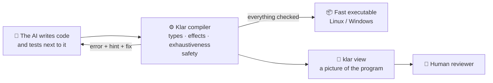

Klar removes whole classes of bugs before the program runs. The model fixes them from precise hints, and the
human reviews the result instead of hunting for bugs.

## 2. A first program

```klar
/// Greeting: run it with `klar run hello.klar`.
fn main() uses io {
  let name = "world"
  print("Hello, {name}!")
}
```

* `fn main() uses io` is the entry point; `uses io` declares that the function prints (section 9).
* `let` is a value that cannot change; `"…{name}…"` interpolates a value into a string.
* No `;` — one statement per line; blocks use `{ }`.

```sh
klar run hello.klar      # compile to machine code and run
klar build hello.klar    # hello / hello.exe — a single file without dependencies
```

## 3. Data types

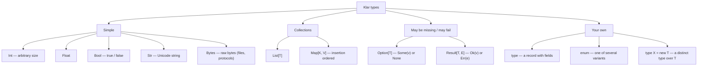

```klar
type Point { x: Float, y: Float }                       // a record

enum Shape {                                            // variants
  Circle(radius: Float),
  Rect(w: Float, h: Float),
}

fn main() uses io {
  let p = Point { x: 1.0, y: 2.0 }
  let _shape = Shape.Circle(radius: 2.0)                // a leading `_` means "not used yet"
  let big = 2.pow(100)                                  // Int never overflows
  print("{p.x} {big}")
}
```

When a number has a meaning, give it a type of its own — a **newtype**. Meters will not add to seconds, and a
percentage stays in range: the constructor checks the `requires` lines, and there is no other way to get a value.

```klar
type Meters = new Float

type Percent = new Int
  requires value >= 0 and value <= 100

fn main() uses io {
  let d = Meters(2.5)                                   // build: Meters(x); read: d.value
  let p = Percent(42)                                   // Percent(150) is a compile error (E0703)
  print("{d.value} m, {p.value}%")
}
```

**There is no `null` and no exceptions.** "There may be no value" is visible in the type (`Option`), and so is
"this may fail" (`Result`); the compiler does not let you forget either case.

## 4. Immutability: values never change, names are rebound

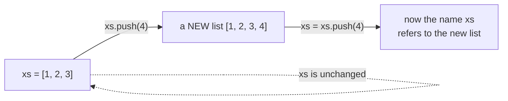

```klar
fn main() uses io {
  var xs = [1, 2, 3]       // var: the name can be rebound
  xs = xs.push(4)          // correct: keep the new list
  let ys = xs.push(5)      // ys = [1, 2, 3, 4, 5], xs = [1, 2, 3, 4]
  print("{xs} {ys}")
}
```

A bare `xs.push(4)` statement is **a compile error** (E0405) — the most common model mistake. Immutability makes
code predictable: passing a value to a function never changes it behind your back. It costs no speed: when a
list has only one reference, the compiler quietly updates it in place — also when the state is passed through
functions (`s = add(s, x)`, `return s with { items: s.items.push(x) }`).

## 5. Functions: the signature is a contract

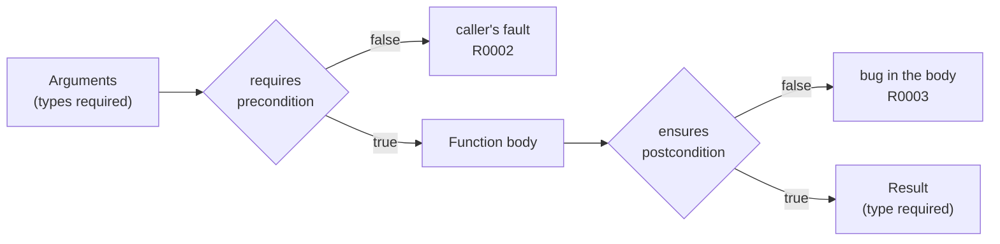

```klar
/// Splits a sum evenly.
/// >>> assert share(total: 10, people: 3, min: 1) == 3
fn share(total: Int, people: Int, min: Int) -> Int
  requires people > 0
  ensures result >= 0 or total < 0
{
  let part = total / people
  return part.max(min)
}

fn main() uses io {
  print(share(total: 100, people: 4, min: 1))
}
```

* Parameter and result types are always written: a function can be understood from one line.
* With 3+ parameters, calls must name the arguments — arguments cannot be swapped by accident.
* `/// >>>` is an example in the documentation that `klar test` runs as a test.
* `total / people` compiles only because `requires people > 0` proves the divisor is not zero (section 11).

## 6. Option, Result and `?`

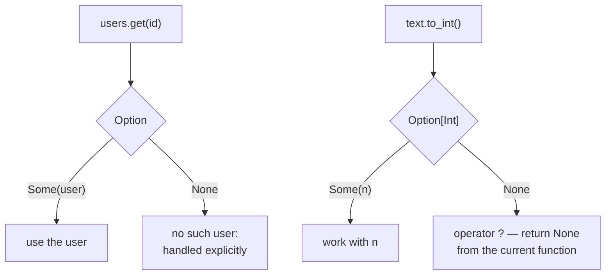

```klar
fn age_next_year(ages: Map[Str, Int], name: Str) -> Option[Int] {
  let age = ages.get(name)?          // None -> the function returns None right away
  return Some(age + 1)
}

fn main() uses io {
  let ages = Map { "ann": 31 }
  match age_next_year(ages, "bob") {
    Some(a) => print("will be {a}"),
    None => print("unknown person"),
  }
  print(ages.get("ann").unwrap_or(0))   // or a default value
}
```

An `Option` cannot be used as a plain number: `ages.get(name) + 1` is a compile error that tells you to handle
`None`. For errors with details there is `Result[T, E]` with `Err(...)`: the function declares in its type that it
may fail, and the caller must handle it (`match`, `?`, or an explicit `let _ =`).

## 7. match: the compiler checks that every case is handled

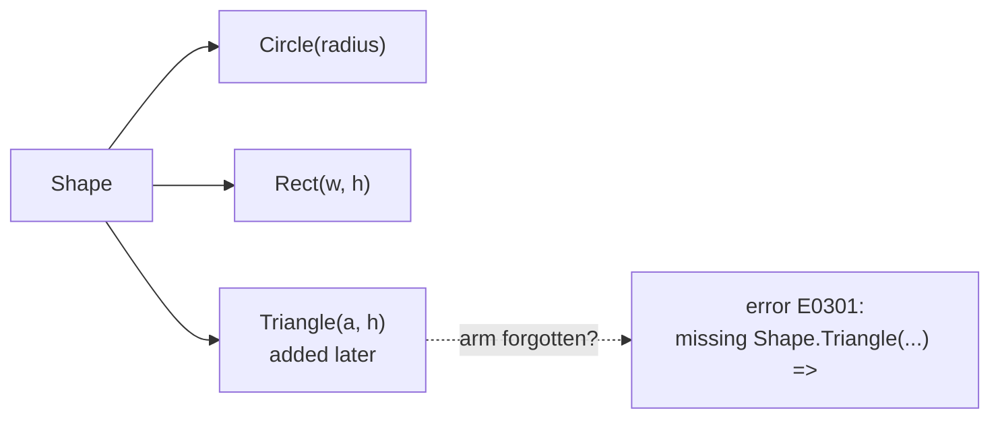

```klar
enum Shape {
  Circle(radius: Float),
  Rect(w: Float, h: Float),
}

fn area(s: Shape) -> Float {
  return match s {
    Shape.Circle(r) => 3.14159 * r * r,
    Shape.Rect(w, h) => w * h,
  }
}

fn label(n: Int) -> Str {
  return match n {
    0 => "zero",
    x if x < 0 => "negative",           // a guard
    _ => "positive",
  }
}

fn main() uses io {
  print("{area(Shape.Rect(w: 2.0, h: 3.0))} {label(-5)}")
}
```

Add a variant to an `enum` and the compiler lists every `match` that does not handle it, with the text of the
missing arm. `match` also replaces the ternary operator: `let sign = match n > 0 { true => 1, false => -1 }`.

## 8. Traits: shared behaviour of different types

A trait is a list of methods a type promises to have. A generic function with a bound `[T: Shape]` accepts any
type that has an `impl Shape` and may call those methods.

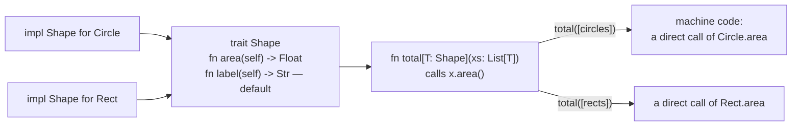

```klar
trait Shape {
  fn area(self) -> Float
  fn label(self) -> Str {               // a default method: an impl may leave it out
    return "a shape of area {self.area()}"
  }
}

type Circle { radius: Float }
type Rect { w: Float, h: Float }

impl Shape for Circle {
  fn area(self) -> Float {
    return 3.14159 * self.radius * self.radius
  }
}

impl Shape for Rect {
  fn area(self) -> Float {
    return self.w * self.h
  }
  fn label(self) -> Str {               // its own version instead of the default
    return "a {self.w}×{self.h} rectangle"
  }
}

fn total[T: Shape](xs: List[T]) -> Float {
  return xs.map(fn(s) => s.area()).sum_float()
}

fn main() uses io {
  print(total([Circle { radius: 1.0 }, Circle { radius: 2.0 }]))
  print(Rect { w: 2.0, h: 3.0 }.label())
}
```

What the compiler checks:

| error | when |
|---|---|
| E0221 | an `impl` lacks a required method, has an extra one, or a signature differs from the trait (`klar fix` inserts `todo(...)` stubs) |
| E0220 | `total([points])` without `impl Shape for Point`; or a parameter `U` lacks the bound `[U: Shape]` |
| E0222 | a second `impl` of the same trait for the same type, or an `impl` outside the trait's/type's module |
| E0224 | a trait used as a type (`fn f(s: Shape)`) |

The rules are simple. Trait methods always take `self` first. Inside a trait, `Self` means "the type that
implements it". Impls are written for `Int`, `Float`, `Bool`, `Str`, `Bytes` and your own `type`s and `enum`s. For
generic types the impl is generic too: `impl[T: Show] Show for List[T]` gives `show()` to every list whose elements
can `show()`, and `impl[T] Show for Box[T]` to every `Box`. For a list
of different shapes, declare an `enum` with one variant per shape and implement the trait for it: each method
is one `match`.

## 9. Effects: the signature says what a function does to the world

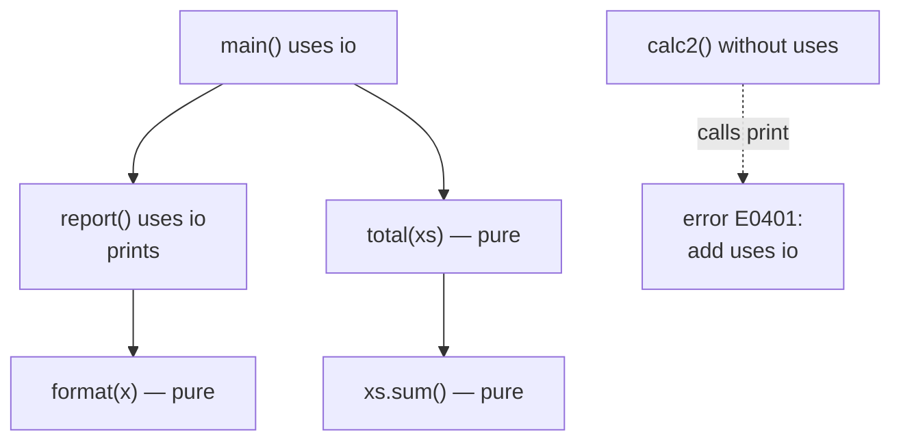

| effect | allows |
|---|---|
| `io` | printing, reading input, `dbg` |
| `fs` | files (`read_file`, `write_file` return `Result`) |
| `time` | the clock (`now_ms`, `now_ns`) |
| `rand` | random numbers |
| `net` | network (reserved) |

A function without `uses` is **pure**: the same arguments always give the same result, so it is easy to test and
safe to call. `klar view` colours such functions green.

### Parallelism: `par_map`

Purity is what makes parallel code safe. `xs.par_map(f)` gives the same list as `xs.map(f)`, but in native code it
spreads the elements over the CPU cores (worker processes, one contiguous chunk per core):

```klar
fn score(doc: Str) -> Int {          // pure: no `uses`
  return doc.split(" ").filter(fn(w) => w.len() > 3).len()
}

fn main() uses io {
  let docs = ["the quick brown fox", "jumps over the lazy dog", "hello parallel world"]
  let scores = docs.par_map(score)    // all cores; same result and order as map
  print(scores.sum())                 // the effects come afterwards, in main
}

test "par_map gives the result of map" {
  let docs = ["a bb ccc dddd", "eeeee"]
  assert docs.par_map(score) == docs.map(score)
}
```

The compiler checks what makes this safe (error E0406 / E0401):
* `f` is a lambda that uses no effects, or the name of a function without `uses` — nothing can print, write a file
  or read the clock from another process;
* the results contain no functions (they are sent back between processes).

There are no locks, no data races and no "sometimes" bugs: values are immutable and `f` is pure, so the result
cannot depend on timing. A runtime error inside `f` is reported exactly as `map` would report it (the first failing
element). Where there are no worker processes (Windows for now, one CPU, the interpreter) `par_map` is `map`.

## 10. Tests are part of the language

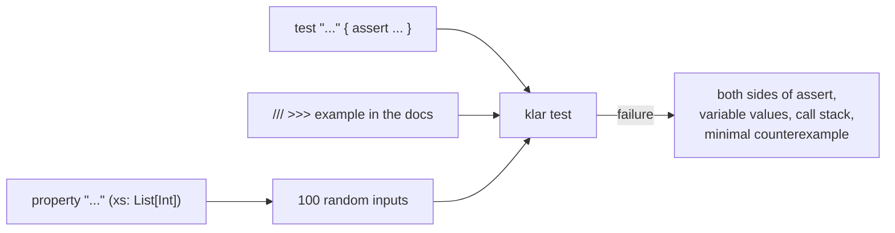

```klar
fn reverse_twice(xs: List[Int]) -> List[Int] {
  return xs.reverse().reverse()
}

test "small example" {
  assert reverse_twice([1, 2]) == [1, 2]
}

property "reverse twice changes nothing" (xs: List[Int]) {
  assert reverse_twice(xs) == xs
}
```

A property is checked on a hundred random inputs; on failure Klar **shrinks** the input to a minimal example
(e.g. `xs = [0, 1]`) so the cause is obvious.

## 11. Safety before the program runs

Klar follows Rust's principle: what can be found at compile time is found by the compiler.

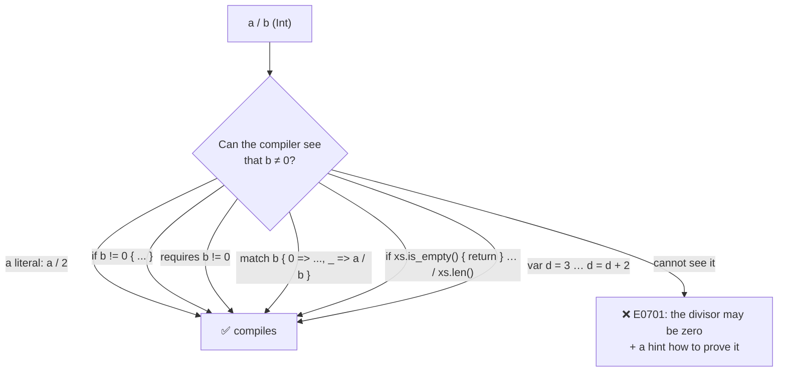

Also rejected before running:

| mistake | code |
|---|---|
| using an `Option`/`Result` as a plain value | E0211 |
| discarding the result of `push`/`trim`/`set` | E0405 |
| an unhandled `enum` variant in `match` | E0301 |
| an unhandled `Result` | E0402 |
| swappable arguments (3+ parameters without names) | E0208 |
| shadowing a variable | E0102 |
| calling an effectful function without `uses` | E0401 |
| recursion without a base case | E0702 |
| a call that certainly violates `requires` (constants, or `if n < 0 { root(n) }`) | E0703 |
| a `return` that certainly violates `ensures` (`ensures result > 0` and `return 0`) | E0706 |
| `2.pow(-1)`, `(-1.0).sqrt()`, `xs.chunks(0)` | E0704 |
| `xs.get(xs.len())` — always out of bounds | E0705 |
| sorting values that have no order | E0215 |

`klar explain <code>` explains each one. Integer overflow, `null`, exceptions and data races do not exist in Klar.

## 12. Modules

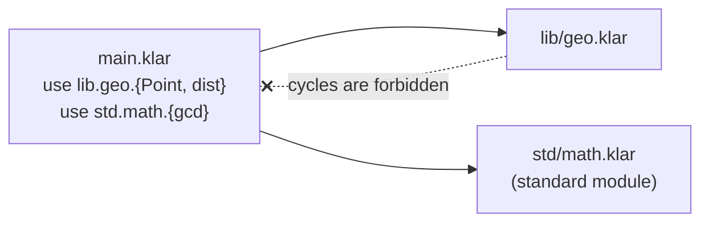

A module is a file. Imports are explicit (`use a.b.{x, y}`), type names are unique in the whole program, and import
cycles are forbidden — so a name always leads back to its origin (`klar refs`).

Only `pub` declarations can be imported; everything else is the module's own business:

```text
// lib/geo.klar
pub type Point { x: Float, y: Float }     // visible outside
fn square(v: Float) -> Float { ... }      // a helper for this file only
pub fn dist(p: Point) -> Float { ... }
```

A module's public interface is exactly its `pub` lines (`klar outline` shows them first thing). Importing a
private name is error E0606 and `klar fix` adds the `pub`. A private function nothing calls (tests count) is
warning W0406: dead code.

### Packages

A project is a directory with a `klar.toml` (`klar new` writes one). It lists the dependencies:

```toml
[package]
name = "app"
version = "0.1.0"

[dependencies]
geometry = { path = "../geometry" }                                   # a directory with its own klar.toml
json5 = { git = "https://github.com/someone/json5.git", tag = "v1.2.0" }   # or rev = "...", branch = "main"
```

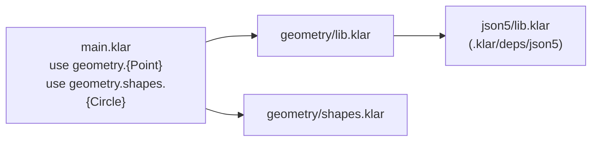

The first part of a `use` is the dependency's name: `use geometry.{Point}` loads the package's `lib.klar`,
`use geometry.shapes.{...}` its `shapes.klar`. A package's modules are named after it (`geometry`,
`geometry.shapes`), so they never clash with yours. A dependency name means one package in the whole program: two
`klar.toml` files giving it different sources is E0608.

| I want to | command |
|---|---|
| add a dependency | `klar add json5 --git URL --tag v1.2.0` or `klar add geometry --path ../geometry` |
| get the dependencies after `git clone` | `klar fetch` (checks out the commits in `klar.lock`) |
| move to newer commits | `klar update [name]` |
| see the tree | `klar deps` (`--json` for an agent) |
| drop one | `klar remove name` |

Git dependencies live in `.klar/deps/` (git-ignored), their exact commits in `klar.lock` (commit it). There is no
central registry: a package is a git repository with `klar.toml` and `lib.klar` (`klar new name --lib`).

## 13. How an AI works with Klar

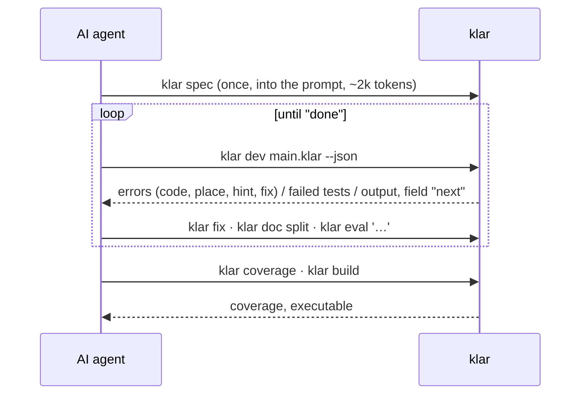

## 14. Cheat sheet: "I want → I write"

| I want | I write |
|---|---|
| an immutable value / a variable | `let x = 1` / `var n = 0`, then `n = n + 1` |
| a conditional value (ternary) | `match ok { true => "yes", false => "no" }` |
| length, element, last | `xs.len()`, `xs.get(i)` → `Option`, `xs.last()` |
| add to a list / map | `xs = xs.push(v)`, `m = m.set(k, v)` |
| loop over numbers | `for i in range(0, n) { ... }` |
| a string with a number | `"total: {n}"` |
| convert | `n.to_float()`, `f.round()`, `s.to_int()` → `Option[Int]`, `x.to_str()` |
| update a record field | `p with { x: 2.0 }` |
| a number with a meaning and bounds | `type Percent = new Int` + `requires value <= 100`, `Percent(5)`, `p.value` |
| a default value | `opt.unwrap_or(0)` |
| pass an error on | `let v = parse(s)?` |
| a lambda | `xs.map(fn(x) => x * 2)` |
| use all CPU cores | `xs.par_map(f)` (`f` pure; same result as `map`) |
| debug | `dbg(x)` prints the expression and its value |
| a placeholder | `todo("write later")` |
| bit operations | `a.bit_and(b)`, `a.bit_xor(b)`, `a.shift_left(3)` (there are no `&`, `\|`, `<<` operators) |
| character codes | `"hé".codes()` → `[104, 233]`, `65.to_char()` → `Some("A")` |
| a set | `use std.set.{set_of}`, `set_of([1, 2]).has(1)` |
| bytes, binary files | `var b = bytes_of([])`, `b = b.push_le(n, 4)`, `write_bytes(path, b)` |
| JSON | `use std.json.{parse_json, lookup, json_text}`, `lookup(parse_json(text)?, "users.0.name")` |
| date and time (UTC) | `use std.time.{now_utc, format_iso, parse_iso}`, `format_iso(now_utc())` |
| an element or a default | `xs.get_or(i, 0)` |
| a shared method of different types | `trait Shape { fn area(self) -> Float }`, `impl Shape for Circle { ... }` |
| a function for any type with a method | `fn total[T: Shape](xs: List[T]) -> Float` |
| a list of different shapes | `enum AnyShape { ... }` + `impl Shape for AnyShape` (a trait is not a type) |
| environment variable, exit code | `env_var("HOME")` → `Option[Str]`, `exit(1)` (effect `io`) |

Details of every function: `klar doc <name>`; check behaviour: `klar eval '<expression>'`.
