# Klar за 20 минут — руководство в картинках

Это руководство для людей: что за язык, как на нём писать и читать, почему он устроен именно так.
Справочник для моделей — `klar spec`, полная грамматика — [SPEC.md](SPEC.md), устройство компилятора — [ARCHITECTURE.md](ARCHITECTURE.md).

---

## 1. Идея: ИИ пишет, компилятор проверяет, человек читает

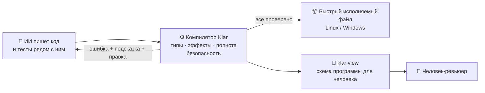

Klar убирает целые классы ошибок ещё до запуска. Модель исправляет их по точным подсказкам,
а человек смотрит на результат, а не ищет баги.

## 2. Первая программа

```klar
/// Приветствие: запустите `klar run hello.klar`.
fn main() uses io {
  let name = "мир"
  print("Привет, {name}!")
}
```

* `fn main() uses io` — точка входа. `uses io` объявляет, что функция печатает (подробнее — раздел 9).
* `let` — значение, которое нельзя изменить. `"…{name}…"` — подстановка значения в строку.
* Нет `;`: одна инструкция на строку. Блоки — в `{ }`.

```sh
klar run hello.klar      # скомпилировать в машинный код и запустить
klar build hello.klar    # получить hello / hello.exe — один файл без зависимостей
```

## 3. Типы данных

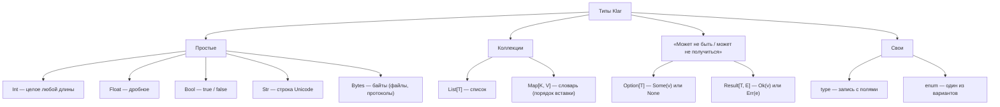

```klar
type Point { x: Float, y: Float }                       // запись

enum Shape {                                            // варианты
  Circle(radius: Float),
  Rect(w: Float, h: Float),
}

fn main() uses io {
  let p = Point { x: 1.0, y: 2.0 }
  let _shape = Shape.Circle(radius: 2.0)                // `_` в начале имени: «пока не используется»
  let big = 2.pow(100)                                  // Int не переполняется
  print("{p.x} {big}")
}
```

**Нет `null` и нет исключений.** Если значения может не быть, это видно по типу (`Option`). Если операция
может не удаться, это тоже видно по типу (`Result`). Компилятор не даст забыть оба случая.

## 4. Неизменяемость: значения не меняются, меняются имена

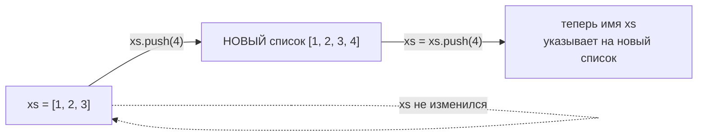

```klar
fn main() uses io {
  var xs = [1, 2, 3]       // var — имя можно перепривязать
  xs = xs.push(4)          // правильно: сохранили новый список
  let ys = xs.push(5)      // ys = [1, 2, 3, 4, 5], xs = [1, 2, 3, 4]
  print("{xs} {ys}")
}
```

Строка `xs.push(4)` без присваивания — **ошибка компиляции** E0405: это самая частая ошибка моделей.
Неизменяемость делает код предсказуемым: если значение передано в функцию, ничего «само» не поменяется.
Скорости это не мешает: если на список ссылается только одно имя, компилятор незаметно меняет его на месте.

## 5. Функции: сигнатура — это договор

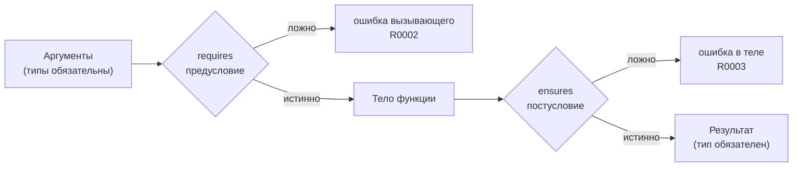

```klar
/// Делит сумму поровну.
/// >>> assert share(total: 10, people: 3, min: 1) == 3
fn share(total: Int, people: Int, min: Int) -> Int
  requires people > 0
  ensures result >= 0 or total < 0
{
  let part = total / people
  return part.max(min)
}

fn main() uses io {
  print(share(total: 100, people: 4, min: 1))
}
```

* Типы параметров и результата всегда записаны: функцию можно понять по одной строке.
* Если у функции 3 параметра и больше, при вызове нужно писать имена: `share(total: 100, people: 4, min: 1)`.
  Так нельзя перепутать порядок аргументов.
* `/// >>>` — пример в документации, который `klar test` запускает как тест.
* `total / people` компилируется только потому, что `requires people > 0` доказывает: делитель не ноль (раздел 11).

## 6. Option, Result и `?`

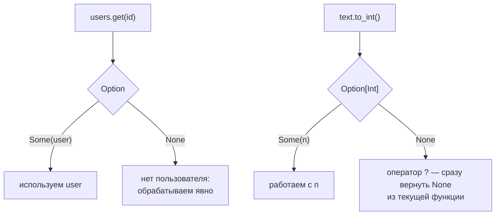

```klar
fn age_next_year(ages: Map[Str, Int], name: Str) -> Option[Int] {
  let age = ages.get(name)?          // None → функция сразу возвращает None
  return Some(age + 1)
}

fn main() uses io {
  let ages = Map { "ann": 31 }
  match age_next_year(ages, "bob") {
    Some(a) => print("будет {a}"),
    None => print("не знаем такого"),
  }
  print(ages.get("ann").unwrap_or(0))   // или значение по умолчанию
}
```

Использовать `Option` как обычное число нельзя: `ages.get(name) + 1` — ошибка компиляции с подсказкой
обработать `None`. Для ошибок с описанием есть `Result[T, E]` и `Err(...)`: функция обязана объявить в типе,
что может не получиться, а вызывающая — обработать это (`match`, `?` или `let _ =` для явного отказа).

## 7. match: компилятор следит, что учтены все случаи

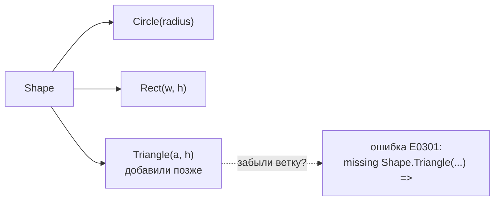

```klar
enum Shape {
  Circle(radius: Float),
  Rect(w: Float, h: Float),
}

fn area(s: Shape) -> Float {
  return match s {
    Shape.Circle(r) => 3.14159 * r * r,
    Shape.Rect(w, h) => w * h,
  }
}

fn label(n: Int) -> Str {
  return match n {
    0 => "ноль",
    x if x < 0 => "отрицательное",     // условие в ветке (guard)
    _ => "положительное",
  }
}

fn main() uses io {
  print("{area(Shape.Rect(w: 2.0, h: 3.0))} {label(-5)}")
}
```

Если в `enum` добавить вариант, компилятор покажет каждый `match`, где он не обработан, вместе с готовым
текстом недостающей ветки. `match` — это ещё и замена тернарного оператора:
`let sign = match n > 0 { true => 1, false => -1 }`.

## 8. Трейты: общее поведение у разных типов

Трейт — это список методов, которые тип обещает иметь. Обобщённая функция с ограничением `[T: Shape]`
принимает любой тип, у которого есть `impl Shape`, и может вызывать эти методы.

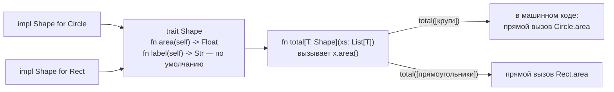

```klar
trait Shape {
  fn area(self) -> Float
  fn label(self) -> Str {               // метод по умолчанию: impl может его не писать
    return "фигура площадью {self.area()}"
  }
}

type Circle { radius: Float }
type Rect { w: Float, h: Float }

impl Shape for Circle {
  fn area(self) -> Float {
    return 3.14159 * self.radius * self.radius
  }
}

impl Shape for Rect {
  fn area(self) -> Float {
    return self.w * self.h
  }
  fn label(self) -> Str {               // свой вариант вместо метода по умолчанию
    return "прямоугольник {self.w}×{self.h}"
  }
}

fn total[T: Shape](xs: List[T]) -> Float {
  return xs.map(fn(s) => s.area()).sum_float()
}

fn main() uses io {
  print(total([Circle { radius: 1.0 }, Circle { radius: 2.0 }]))
  print(Rect { w: 2.0, h: 3.0 }.label())
}
```

Что проверяет компилятор:

| ошибка | когда |
|---|---|
| E0221 | в `impl` нет обязательного метода, лишний метод или сигнатура не совпадает с трейтом (`klar fix` вставит заготовки `todo(...)`) |
| E0220 | `total([точки])`, а `impl Shape for Point` нет; или у параметра `U` нет ограничения `[U: Shape]` |
| E0222 | второй `impl` того же трейта для того же типа или `impl` не в модуле трейта/типа |
| E0224 | трейт использован как тип (`fn f(s: Shape)`) |

Правила простые. Методы трейта всегда принимают `self` первым параметром. `Self` внутри трейта означает «тот тип,
который реализует трейт». `impl` пишут для `Int`, `Float`, `Bool`, `Str` и для своих `type` и `enum`. Нужен список
разных фигур — объявите `enum` с вариантом на каждую фигуру и реализуйте трейт для него: каждый метод будет одним
`match`.

## 9. Эффекты: по сигнатуре видно, что функция делает с миром

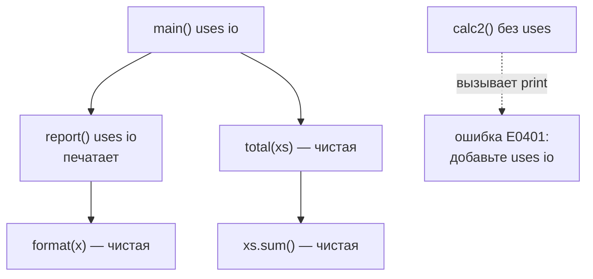

| эффект | что разрешает |
|---|---|
| `io` | печать, чтение ввода, `dbg` |
| `fs` | файлы (`read_file`, `write_file` возвращают `Result`) |
| `time` | часы (`now_ms`, `now_ns`) |
| `rand` | случайные числа |
| `net` | сеть (зарезервировано) |

Функция без `uses` — **чистая**: при одних и тех же аргументах она всегда даёт один и тот же результат.
Её можно тестировать, кэшировать и спокойно вызывать. `klar view` раскрашивает такие функции зелёным.

## 10. Тесты — часть языка

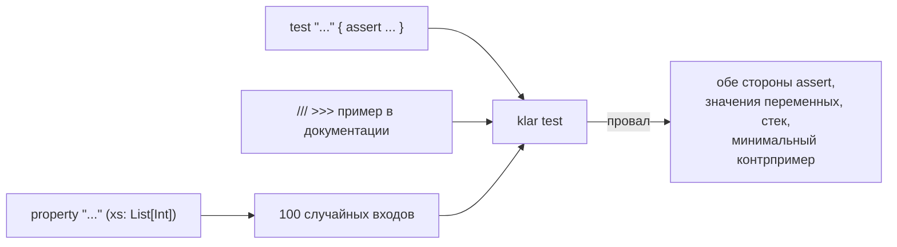

```klar
fn reverse_twice(xs: List[Int]) -> List[Int] {
  return xs.reverse().reverse()
}

test "small example" {
  assert reverse_twice([1, 2]) == [1, 2]
}

property "reverse twice changes nothing" (xs: List[Int]) {
  assert reverse_twice(xs) == xs
}
```

Property-тест проверяет утверждение на сотне случайных входов. Если найдётся провал, Klar **сожмёт** пример до
минимального, например `xs = [0, 1]`, чтобы причину было видно сразу.

## 11. Безопасность до запуска

Klar следует принципу Rust: если ошибку можно найти при компиляции, её находит компилятор.

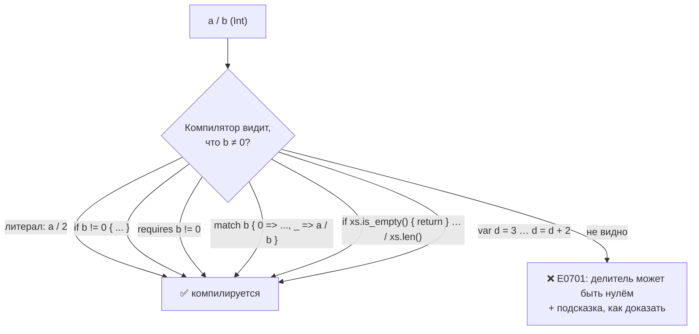

Что ещё отсекается до запуска:

| ошибка | код |
|---|---|
| использовать `Option`/`Result` как обычное значение | E0211 |
| выбросить результат `push`/`trim`/`set` | E0405 |
| не обработать вариант `enum` в `match` | E0301 |
| не обработать `Result` | E0402 |
| перепутать аргументы (≥3 параметров без имён) | E0208 |
| затенить имя переменной | E0102 |
| вызвать функцию с эффектом без `uses` | E0401 |
| рекурсия без базового случая | E0702 |
| вызов с константами, нарушающими `requires` | E0703 |
| `2.pow(-1)`, `(-1.0).sqrt()`, `xs.chunks(0)` | E0704 |
| `xs.get(xs.len())` — индекс всегда за границей | E0705 |
| сортировка значений без порядка | E0215 |

Каждый код объясняет `klar explain <код>`. Переполнения целых, `null`, исключений и гонок данных в Klar нет совсем.

## 12. Модули

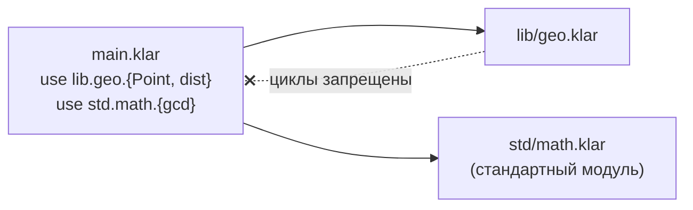

Модуль — это файл. Импорт всегда явный (`use a.b.{x, y}`), имена типов уникальны во всей программе, циклы
импорта запрещены. Поэтому, глядя на имя, всегда можно найти, откуда оно (`klar refs`).

Импортировать можно только объявления с `pub`. Всё остальное — внутреннее дело модуля:

```text
// lib/geo.klar
pub type Point { x: Float, y: Float }     // видно снаружи
fn square(v: Float) -> Float { ... }      // вспомогательная, только для этого файла
pub fn dist(p: Point) -> Float { ... }
```

Публичный интерфейс модуля — это ровно его строки с `pub`, `klar outline` показывает их первыми словами. Импорт
закрытого имени — ошибка E0606, `klar fix` сам добавит `pub`. Закрытая функция, которую никто не вызывает (тесты
считаются), — предупреждение W0406: это мёртвый код.

## 13. Как ИИ работает с Klar

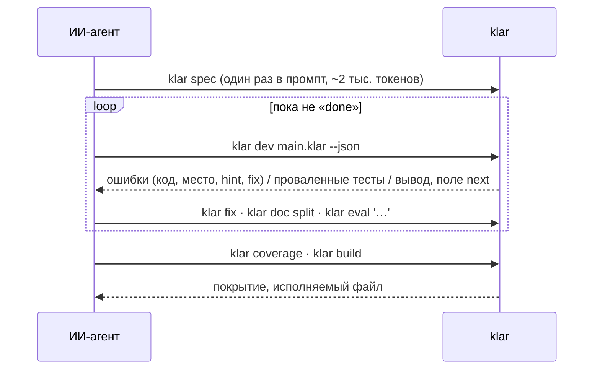

## 14. Шпаргалка «хочу → пишу»

| хочу | пишу |
|---|---|
| неизменяемое значение / переменная | `let x = 1` / `var n = 0`, затем `n = n + 1` |
| условие-значение (тернарник) | `match ok { true => "да", false => "нет" }` |
| длина, элемент, последний | `xs.len()`, `xs.get(i)` → `Option`, `xs.last()` |
| добавить в список / словарь | `xs = xs.push(v)`, `m = m.set(k, v)` |
| пройти по числам | `for i in range(0, n) { ... }` |
| строка с числом | `"total: {n}"` |
| преобразовать | `n.to_float()`, `f.round()`, `s.to_int()` → `Option[Int]`, `x.to_str()` |
| обновить поле записи | `p with { x: 2.0 }` |
| значение по умолчанию | `opt.unwrap_or(0)` |
| пробросить ошибку | `let v = parse(s)?` |
| лямбда | `xs.map(fn(x) => x * 2)` |
| отладка | `dbg(x)` печатает выражение и значение |
| заглушка | `todo("написать позже")` |
| битовые операции | `a.bit_and(b)`, `a.bit_xor(b)`, `a.shift_left(3)` (операторов `&`, `\|`, `<<` нет) |
| коды символов | `"hé".codes()` → `[104, 233]`, `65.to_char()` → `Some("A")` |
| множество | `use std.set.{set_of}`, `set_of([1, 2]).has(1)` |
| байты, двоичные файлы | `var b = bytes_of([])`, `b = b.push_le(n, 4)`, `write_bytes(path, b)` |
| JSON | `use std.json.{parse_json, lookup, json_text}`, `lookup(parse_json(text)?, "users.0.name")` |
| дата и время (UTC) | `use std.time.{now_utc, format_iso, parse_iso}`, `format_iso(now_utc())` |
| элемент или значение по умолчанию | `xs.get_or(i, 0)` |
| общий метод у разных типов | `trait Shape { fn area(self) -> Float }`, `impl Shape for Circle { ... }` |
| функция для любого типа с методом | `fn total[T: Shape](xs: List[T]) -> Float` |
| список разных фигур | `enum AnyShape { ... }` + `impl Shape for AnyShape` (трейт — не тип) |
| переменная окружения, код выхода | `env_var("HOME")` → `Option[Str]`, `exit(1)` (эффект `io`) |

Подробности по каждой функции — `klar doc <имя>`, проверить поведение — `klar eval '<выражение>'`.
