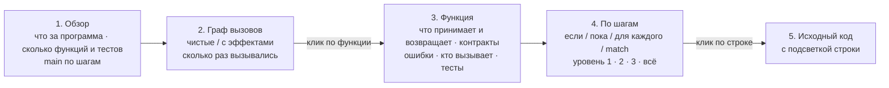
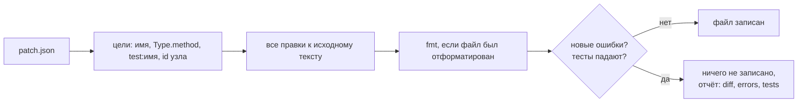
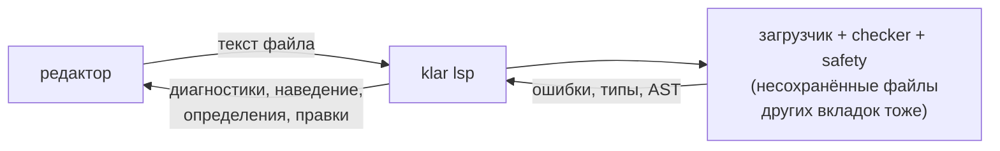

# Инструменты Klar

Klar задуман так, что основной автор кода — языковая модель, а человек — ревьюер. Поэтому у тулчейна две аудитории:

* **ИИ-автору** нужно тратить меньше шагов и токенов: узнать API, не читая файлы целиком; проверить поведение
  встроенной функции, не создавая программу; исправлять ошибки по машинным подсказкам; видеть, что не покрыто тестами;
* **человеку** нужно быстро понять, что делает программа, — в целом и углублённо по требованию.

У всех команд есть `--json` (компактный однострочный JSON для агента), кроме `new`.

## Карта команд

| задача | команда | что даёт |
|---|---|---|
| один шаг цикла разработки | `klar dev file.klar --json` | проверка + тесты + запуск, поле `next` — что делать дальше |
| проверить | `klar check file.klar` | ошибки с кодом, местом, подсказкой и правкой |
| исправить механические ошибки | `klar fix file.klar` | применяет все безопасные правки (`;`, `&&`, именованные аргументы, эффекты…) |
| привести к единому виду | `klar fmt [пути]` | канонический формат; `--check` для CI, `--diff` для просмотра |
| узнать API файла | `klar outline file.klar` | сигнатуры, типы, константы, тесты — несколько строк вместо файла |
| найти функцию / метод | `klar doc split`, `klar doc List.sort` | сигнатура + описание + проверенные примеры (встроенные, std, проект: `--in file`) |
| проверить поведение | `klar eval '"a,b".split(",")'` | `["a", "b"] : List[Str]` — значение и тип |
| где используется имя | `klar refs file.klar name` | определение и все использования во всех модулях |
| переименовать | `klar rename file.klar old new` | во всех модулях; отказ, если новое имя уже занято |
| изменить код | `klar patch file.klar patch.json --test` | правки по имени объявления или `id` узла; пишется, только если нет новых ошибок и тесты проходят |
| что не покрыто тестами | `klar coverage file.klar` | процент инструкций и строки, которые тесты не выполняют |
| понять программу (человеку) | `klar view file.klar --run` | интерактивная HTML-страница: обзор → граф вызовов → функция по шагам |
| начать проект | `klar new имя` | `main.klar` с тестом и doc-тестом, `AGENTS.md`, README, `.gitignore` |
| тесты | `klar test file.klar` | test, doc-тесты, property-тесты со сжатием контрпримера |
| производительность | `klar profile file.klar` | время по функциям и горячие строки |
| сборка | `klar build file.klar [--target windows]` | один исполняемый файл без зависимостей |
| справка по языку | `klar spec`, `klar explain E0701` | полный справочник (~2 тыс. токенов), объяснение кода ошибки |
| попробовать в диалоге | `klar repl` | интерактивная сессия: выражения, переменные, функции, `:type`, `:doc`, `:load` |
| редактор | `klar lsp` | языковой сервер: ошибки при наборе, наведение, определения, ссылки, переименование, дополнение |

## klar view — программа глазами человека

```sh
klar view examples/bank.klar --run --open
```

Создаёт один HTML-файл без зависимостей (открывается без интернета). Интерфейс на русском или английском, переключатель вверху.




1. **Обзор.** Что за программа (комментарий к `main`), сколько функций, типов и тестов. Какие функции имеют побочные эффекты.
   Что делает `main` — по шагам.
2. **Граф вызовов.** Кто кого вызывает, начиная с `main`. Зелёные функции — чистые, оранжевые — с побочными
   эффектами (ввод-вывод, файлы, время), пунктир — функции из других модулей. С `--run` на узлах стоит число
   вызовов при реальном запуске; функции, которые не выполнялись, бледные. Внизу — вывод программы.
3. **Функция.** По клику:
   * описание: что принимает, что возвращает, контракты `requires`/`ensures`, эффекты, какие ошибки может вернуть,
     кого вызывает и кем вызывается, какими тестами проверяется, примеры из doc-тестов;
   * **«Что делает, по шагам»** — управляющая логика вложенными блоками: если / иначе, повторять пока, для каждого,
     в зависимости от (`match`), вернуть. Уровень детализации 1 / 2 / 3 / всё, любой блок раскрывается кликом;
   * исходный код; клик по номеру строки в схеме подсвечивает её в коде.
4. **Типы данных и константы.**


## klar fmt — канонический вид

Форматер сохраняет разбиение на строки и комментарии автора. Он нормализует отступы (2 пробела на уровень,
+1 для строк-продолжений `.method` и `requires`/`ensures`), пробелы вокруг операторов, после `,` и `:`, пустые
строки (не больше одной подряд, одна между объявлениями верхнего уровня). Встроенная страховка: результат
должен давать тот же поток токенов, иначе файл не трогается. Весь код репозитория уже в каноническом виде;
тест `DeveloperTools` следит за этим.

## klar eval — проверить, не создавая файл

```sh
klar eval '"a,b,,c".split(",")'                    # ["a", "b", "", "c"] : List[Str]
klar eval 'let xs = [3, 1, 2]' 'xs.sort().map(fn(x) => x * 10)'   # [10, 20, 30] : List[Int]
klar eval 'gcd(12, 18)' --in klar/std/math.klar     # 6 : Int
```

Все аргументы, кроме последнего, — инструкции; последний — выражение. С `--in` доступны функции и типы файла.
Ошибки компиляции показываются с номером строки ввода.

## klar repl — интерактивная сессия

```text
klar> let xs = [3, 1, 2]
klar> xs.sort()
[1, 2, 3] : List[Int]
klar> fn double(n: Int) -> Int {
....>   return n * 2
....> }
defined double
klar> xs.map(double)
[6, 2, 4] : List[Int]
klar> :type xs.map(fn(x) => x.to_float())
List[Float]
```

Каждый ввод проверяется вместе со всеми предыдущими, по тем же правилам, что и программа (нет затенения, нет
неявных преобразований, разрешены эффекты `io`, `time`, `rand`, `fs`). Выполняется только новое: прошлые
`print` и `read_line` не повторяются, переменные сохраняются. Ввод с ошибкой не меняет сессию. Команды:
`:type`, `:doc`, `:load файл` (объявления файла без `main`), `:defs`, `:reset`, `:quit`.

## klar refs / rename — точная навигация

В Klar запрещено затенение, а имена типов уникальны во всей программе. Поэтому имя однозначно указывает на
сущность, и поиск по AST точен без полноценной IDE. `rename` меняет определение, все использования,
импорты, именованные аргументы, поля, варианты и интерполяции в строках, после чего перепроверяет программу.

## klar patch — проверенные правки (протокол «AI patch»)

Переписывать файл целиком дорого, а правки по номерам строк ломаются при первом же сдвиге. `klar patch` принимает
JSON со списком правок, которые называют *что* меняется:

```json
{"edits": [
  {"replace": "area", "with": "fn area(s: Shape) -> Float { ... }"},
  {"replace": "Circle.area", "with": "..."},
  {"insert": "fn helper() -> Int {\n  return 1\n}", "after": "area"},
  {"delete": "test:old"},
  {"id": 42, "with": "x + 1"},
  {"find": "let n = 0", "replace": "let n = 1", "in": "main"},
  {"rename": "total", "to": "sum"}
], "test": true}
```



* **Цели**: имя функции, типа, перечисления, константы, трейта; `Type.method`; `test:имя`, `property:имя`;
  `impl Trait for Type`; любой узел по `id` (его печатает `klar ast`). Для неизвестного имени — «did you mean».
* Все правки относятся к файлу *до* патча и применяются вместе; пересекающиеся правки отклоняются.
* Doc-комментарий над заменяемым объявлением сохраняется, если новый код не начинается с `///`.
* `find` требует, чтобы текст встречался ровно один раз (в объявлении из `in` или во всём файле).
* Файл записывается, только если патч не добавил ошибок и (с `"test": true` или `--test`) все тесты проходят.
  `--dry-run` — только отчёт, `--force` — записать в любом случае. Отчёт `--json`: `ok`, `written`, `applied`,
  `diff`, `errors`, `tests`.
* PATCH — путь к JSON-файлу, `-` (stdin) или сам JSON.

## klar coverage — что не проверено

```text
coverage of bank.klar: 83.3% of statements (10/12), 4 tests
!!  80%  withdraw (line 22)
         never run: 26: return Err(BankError.InvalidAmount(amount: amount))
!!   0%  describe (line 51)
```

`--main` дополнительно запускает `main`, `--min 90` возвращает код 1 ниже порога (удобно для CI).

## Редакторы

`editors/vscode/` — расширение для VS Code. Оно даёт:
* подсветку синтаксиса, включая интерполяцию строк и doc-тесты;
* сниппеты `fn`, `main`, `test`, `property`, `match`, `type`, `enum`, `trait`, `impl`;
* разбор вывода `klar check` в список ошибок (`$klar`).

Расширение подключает языковой сервер `klar lsp` (раздел ниже).

## klar lsp — языковой сервер

`klar lsp` — сервер Language Server Protocol (stdin/stdout, без зависимостей). Он работает в любом редакторе
с поддержкой LSP: VS Code (расширение в `editors/vscode`), Neovim, Helix, Zed, Sublime, JetBrains.

| возможность | что делает |
|---|---|
| диагностики | ошибки и предупреждения при наборе, с кодом и подсказкой (3–40 мс на файл) |
| быстрые исправления | те же правки, что применяет `klar fix`, в том числе в другом файле (`pub` в модуле) |
| наведение | тип переменной, сигнатура и документация функции, метода, трейта, типа |
| переход к определению | в том числе в импортированные модули, к методам `impl` и вариантам `enum` |
| ссылки, переименование | точные: затенения нет, локальные имена не выходят за свою функцию |
| автодополнение | имена в области видимости, после `.` — методы и поля типа значения |
| подсказка сигнатуры | параметры функции или метода и номер текущего аргумента |
| символы, форматирование | структура файла (трейты и `impl` с методами), `klar fmt` |



Пример для Neovim (`init.lua`):

```lua
vim.filetype.add({ extension = { klar = "klar" } })
vim.api.nvim_create_autocmd("FileType", { pattern = "klar", callback = function()
  vim.lsp.start({ name = "klar", cmd = { "python3", "-m", "klar", "lsp" } })
end })
```

Если редактор ведёт себя странно, запустите сервер с `KLAR_LSP_LOG=/tmp/klar-lsp.log`: в журнал попадут
все сообщения и ошибки.

## AGENTS.md

`klar new` кладёт в проект `AGENTS.md` — короткую инструкцию для ИИ-ассистентов: цикл `dev → fix → fmt`,
инструменты поиска и правила, которые проверяет компилятор. В корне этого репозитория есть такой же файл для
тех, кто дорабатывает сам компилятор.
