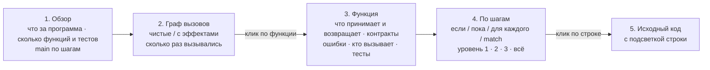

# Инструменты Klar

Klar задуман так, что основной автор кода — языковая модель, а человек — ревьюер. Поэтому у тулчейна две аудитории:

* **ИИ-автору** нужно тратить меньше шагов и токенов: узнать API, не читая файлы целиком; проверить поведение
  встроенной функции, не создавая программу; исправлять ошибки по машинным подсказкам; видеть, что не покрыто тестами;
* **человеку** нужно быстро понять, что делает программа, — в целом и углублённо по требованию.

У всех команд есть `--json` (компактный однострочный JSON для агента), кроме `new`.

## Карта команд

| задача | команда | что даёт |
|---|---|---|
| один шаг цикла разработки | `klar dev file.klar --json` | проверка + тесты + запуск, поле `next` — что делать дальше |
| проверить | `klar check file.klar` | ошибки с кодом, местом, подсказкой и правкой |
| исправить механические ошибки | `klar fix file.klar` | применяет все безопасные правки (`;`, `&&`, именованные аргументы, эффекты…) |
| привести к единому виду | `klar fmt [пути]` | канонический формат; `--check` для CI, `--diff` для просмотра |
| узнать API файла | `klar outline file.klar` | сигнатуры, типы, константы, тесты — несколько строк вместо файла |
| найти функцию / метод | `klar doc split`, `klar doc List.sort` | сигнатура + описание + проверенные примеры (встроенные, std, проект: `--in file`) |
| проверить поведение | `klar eval '"a,b".split(",")'` | `["a", "b"] : List[Str]` — значение и тип |
| где используется имя | `klar refs file.klar name` | определение и все использования во всех модулях |
| переименовать | `klar rename file.klar old new` | во всех модулях; отказ, если новое имя уже занято |
| что не покрыто тестами | `klar coverage file.klar` | процент инструкций и строки, которые тесты не выполняют |
| понять программу (человеку) | `klar view file.klar --run` | интерактивная HTML-страница: обзор → граф вызовов → функция по шагам |
| начать проект | `klar new имя` | `main.klar` с тестом и doc-тестом, `AGENTS.md`, README, `.gitignore` |
| тесты | `klar test file.klar` | test, doc-тесты, property-тесты со сжатием контрпримера |
| производительность | `klar profile file.klar` | время по функциям и горячие строки |
| сборка | `klar build file.klar [--target windows]` | один исполняемый файл без зависимостей |
| справка по языку | `klar spec`, `klar explain E0701` | полный справочник (~2 тыс. токенов), объяснение кода ошибки |

## klar view — программа глазами человека

```sh
klar view examples/bank.klar --run --open
```

Создаёт один HTML-файл без зависимостей (открывается без интернета). Интерфейс на русском или английском, переключатель вверху.




1. **Обзор.** Что за программа (комментарий к `main`), сколько функций, типов и тестов. Какие функции имеют побочные эффекты.
   Что делает `main` — по шагам.
2. **Граф вызовов.** Кто кого вызывает, начиная с `main`. Зелёные функции — чистые, оранжевые — с побочными
   эффектами (ввод-вывод, файлы, время), пунктир — функции из других модулей. С `--run` на узлах стоит число
   вызовов при реальном запуске; функции, которые не выполнялись, бледные. Внизу — вывод программы.
3. **Функция.** По клику:
   * описание: что принимает, что возвращает, контракты `requires`/`ensures`, эффекты, какие ошибки может вернуть,
     кого вызывает и кем вызывается, какими тестами проверяется, примеры из doc-тестов;
   * **«Что делает, по шагам»** — управляющая логика вложенными блоками: если / иначе, повторять пока, для каждого,
     в зависимости от (`match`), вернуть. Уровень детализации 1 / 2 / 3 / всё, любой блок раскрывается кликом;
   * исходный код; клик по номеру строки в схеме подсвечивает её в коде.
4. **Типы данных и константы.**


## klar fmt — канонический вид

Форматер сохраняет разбиение на строки и комментарии автора. Он нормализует отступы (2 пробела на уровень,
+1 для строк-продолжений `.method` и `requires`/`ensures`), пробелы вокруг операторов, после `,` и `:`, пустые
строки (не больше одной подряд, одна между объявлениями верхнего уровня). Встроенная страховка: результат
должен давать тот же поток токенов, иначе файл не трогается. Весь код репозитория уже в каноническом виде;
тест `DeveloperTools` следит за этим.

## klar eval — проверить, не создавая файл

```sh
klar eval '"a,b,,c".split(",")'                    # ["a", "b", "", "c"] : List[Str]
klar eval 'let xs = [3, 1, 2]' 'xs.sort().map(fn(x) => x * 10)'   # [10, 20, 30] : List[Int]
klar eval 'gcd(12, 18)' --in klar/std/math.klar     # 6 : Int
```

Все аргументы, кроме последнего, — инструкции; последний — выражение. С `--in` доступны функции и типы файла.
Ошибки компиляции показываются с номером строки ввода.

## klar refs / rename — точная навигация

В Klar запрещено затенение, а имена типов уникальны во всей программе. Поэтому имя однозначно указывает на
сущность, и поиск по AST точен без полноценной IDE. `rename` меняет определение, все использования,
импорты, именованные аргументы, поля, варианты и интерполяции в строках, после чего перепроверяет программу.

## klar coverage — что не проверено

```text
coverage of bank.klar: 83.3% of statements (10/12), 4 tests
!!  80%  withdraw (line 22)
         never run: 26: return Err(BankError.InvalidAmount(amount: amount))
!!   0%  describe (line 51)
```

`--main` дополнительно запускает `main`, `--min 90` возвращает код 1 ниже порога (удобно для CI).

## Редакторы

`editors/vscode/` — расширение для VS Code. Оно даёт:
* подсветку синтаксиса, включая интерполяцию строк и doc-тесты;
* сниппеты `fn`, `main`, `test`, `property`, `match`, `type`, `enum`;
* разбор вывода `klar check` в список ошибок (`$klar`).

LSP запланирован в 0.5.

## AGENTS.md

`klar new` кладёт в проект `AGENTS.md` — короткую инструкцию для ИИ-ассистентов: цикл `dev → fix → fmt`,
инструменты поиска и правила, которые проверяет компилятор. В корне этого репозитория есть такой же файл для
тех, кто дорабатывает сам компилятор.
